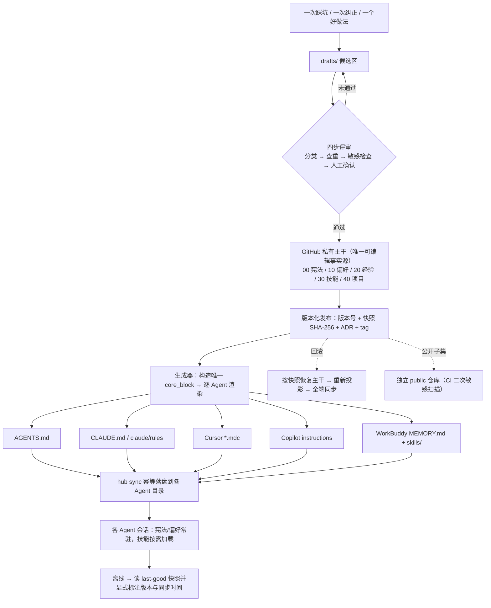

# 个人 AI Agent 规则中枢 · 策划方案

> 需求：沉淀使用 AI Agent 过程中的经验、偏好与技能，分享给不同 Agent，让它们稳定遵守我的规则，并支持同步更新。
> 交付方：软件开发团队（产品经理许清楚 → 架构师高见远 → 主理人齐活林汇编）
> 日期：2026-11-09 ｜ 语言：简体中文
> 详细原文见 `docs/01-PRD.md`（53 KB）与 `docs/02-架构设计.md`（110 KB）；本文为可执行摘要与决策索引。

---

## 0. TL;DR

**你的方向是对的，但要做四处修正**：以 GitHub 私有仓库作「唯一可编辑事实源」，各 Agent 看到的 `AGENTS.md` / `CLAUDE.md` / `*.mdc` / `MEMORY.md` 全部是**自动生成的只读投影**；规则更新走一次评审 + 一次版本化发布 + 一次全端同步，绝不手工逐份修改。

| # | 你的设想 | 修正后 | 为什么 |
| --- | --- | --- | --- |
| 1 | 把规则放 GitHub 供 Agent 调用 | ✅ 可行，但 Agent **不直接读 GitHub**，而是读本机生成的投影文件 | 远程拉取断网即失效；本机快照可离线降级并显式标注版本 |
| 2 | 各 Agent 各自放一份规则 | ❌ 改为**一处编辑、五处生成** | VS Code 官方明确警告多 harness 场景要 "avoid contradictory copies"；人工复制必然产生互相矛盾的副本 |
| 3 | 用软链把仓库文件链到各 Agent 目录 | ❌ Windows 上硬排除 | Git for Windows 官方 Wiki：symlink 默认需管理员/开发者模式，且 `core.symlinks=false` 会把链接降级成纯文本；junction 只支持目录，覆盖不了 `MEMORY.md` 这类单文件 |
| 4 | 一个仓库开个公开分支分享技能 | ❌ 必须**双仓库** | GitHub 官方社区 Verified answer：可见性是仓库级，不能只公开某一个分支 |

**一句话机制**：`主干（唯一可编辑）→ 生成器（编译）→ 只读投影 → 幂等同步 → 本地快照（离线兜底）`，Git 负责版本、回滚与审计。

---

## 1. 问题的本质

你要解决的不是「存起来」，而是三件事：

1. **稳定遵守** —— 不同 Agent 一致地按同一套规则行事，不用每次重新交代；
2. **同步生效** —— 规则更新后所有已接入 Agent 跟上，且不产生多份互相矛盾的副本；
3. **可持续治理** —— 规则会越攒越多，追加式记忆只增不改会「单调变差」，需要查重、复核、过期与回滚。

因此产物是**一套带治理机制的规则资产库**，不是一个文件夹，也不是一份大号 prompt。

---

## 2. 生态调研的关键结论

| 承载方式 | 定位 | 对方案的启示 |
| --- | --- | --- |
| **AGENTS.md** | 跨 Agent 的「最低公分母」，Codex / Cursor / Copilot / Gemini CLI / VS Code 等直接识别；纯 Markdown、就近优先、显式用户指令覆盖一切 | 主干优先投影成它 |
| **Agent Skills（`SKILL.md`）** | Anthropic 发布的**开放标准**，同一份技能目录可在多个兼容 Agent 复用；渐进式披露（启动只加载 name+description） | 技能只写一次，跨 Agent 复用 |
| **CLAUDE.md / Cursor `.mdc` / Copilot `*.instructions.md`** | 各家专属格式，带 frontmatter（`globs` / `applyTo` / `alwaysApply`） | 由生成器从同一份元数据转换，不手写 |
| **WorkBuddy Skills / MEMORY.md / mcp.json** | 用户级与项目级技能、三层记忆、MCP 连接配置 | 可落位，但机制描述来自第三方教程、**未经官方核实，实施前必须本机实测** |
| **MCP / mem0 类记忆服务** | MCP 管「怎么连」，mem0 管「动态事实」 | 是**旁路**，不是事实源：都不提供人工审定、版本化、可回滚、可公开分享 |

三条被反复印证的规律：**就近具体优先 + 显式指令覆盖一切**、**避免矛盾副本**、**追加式记忆会失真**。方案不应与之相悖。

> 完整来源清单（含官方/第三方/未核实标注）见 `docs/01-PRD.md` §1.2；本阶段新增核实的两条硬事实见 `docs/02-架构设计.md` §0.1 [A1][A2]。

---

## 3. 方案总览



---

## 4. 内容模型：三类资产 × 四层

**三类资产回答「是什么」，四层回答「何时生效、强度多高」，两者正交。**

| 资产 | 定义 | 判断口诀 | 是否当硬约束 |
| --- | --- | --- | --- |
| **经验** | 验证过的事实性知识 / 踩坑结论（场景+结论+依据+失效条件） | 去掉它，Agent 会再踩一次坑 | ❌ 仅作参考与修订输入 |
| **偏好** | 我要求稳定遵守的规则与习惯（短祈使句） | 去掉它，输出风格或行为就不像我 | ✅ 参与裁决 |
| **技能** | 可复用 SOP（触发条件+步骤+验收） | 去掉它，同类任务要重新摸索 | ❌ 仅在被激活的任务内生效 |

| 层 | 内容 | 变更频率 | 加载方式 |
| --- | --- | --- | --- |
| **L0 宪法** | 3~5 条真红线（简体中文+结构化 / 严禁编造事实与来源 / 敏感隔离 / 破坏性操作二次确认） | 季度~年级 | 常驻，最短，`override: forbidden` |
| **L1 稳定偏好** | 跨项目通用习惯（表格与 Mermaid 优先、不确定先问、验收标准） | 月度 | 常驻，受长度预算约束 |
| **L2 技能** | 周报生成、生态调研、PRD 撰写等 SOP | 周~月 | 按需渐进加载 |
| **L3 项目临时** | 项目专属例外，**必填 `expires`** | 天~周 | 就近具体优先，过期即失效 |
| **经验区** | 事实性知识库 | 持续产生 | **零投影**：物理上不可能被 Agent 当硬约束读到 |

**关键设计**：经验要「变成规矩」必须走**晋升**流程，用 `supersedes` 建立引用链，**禁止把同一句话复制到偏好正文**。这是避免「越攒越乱」的根本。

### 冲突裁决链（从高到低）

```
0  用户当前会话的显式指令（覆盖一切；触及 L0 红线须二次确认并记审计）
1  L0 宪法（override: forbidden，不可被任何自动规则覆盖）
2  L3 项目临时（status: active 且未过期，就近具体优先）
3  L1 稳定偏好（跨项目默认值）
4  L2 技能 / 经验区（不参与覆盖比较；冲突则判该条目需修订）
```

同层冲突按 `specificity → updated_at（新者胜）→ priority` 裁决；**无法裁决时必须暂停、列出冲突项、向你提问**，禁止 Agent 自行取舍或编造。

---

## 5. 仓库结构（简化）

```text
agent-rules-hub/                    # GitHub 私有仓库，唯一可编辑事实源
├── README.md / GOVERNANCE.md       # 入口 + 治理宪法（裁决链写在这里并投影到各入口顶部）
├── manifest.yaml                   # 版本锚点 + 条目 ID 注册表 + 优先级表 + 上一快照哈希
├── CHANGELOG.md                    # 由发布过程生成，禁止手写
├── 00-constitution/                # L0：CORE.md / SAFETY.md
├── 10-preferences/                 # L1：communication / formatting / workflow
├── 20-experience/                  # 经验：EXP-nnnn-短标题.md + _index.md
├── 30-skills/<name>/SKILL.md       # L2：符合 Agent Skills 开放标准 + references/
├── 40-projects/<proj>/OVERRIDES.md # L3：必填 expires
├── drafts/                         # 候选区，评审前不参与任何发布
├── 90-adapters/**                  # 【只读派生产物】AGENTS.md / CLAUDE.md / *.mdc /
│                                   #   copilot-instructions.md / workbuddy/MEMORY.md + skills/
├── 99-private/                     # 【本地、不入库】私有覆盖层
├── audit/decisions/ · audit/releases/  # ADR 决策记录 + 发布快照（SHA-256 哈希链）
├── hub/                            # Python 工具链：validate/plan/publish/sync/rollback/status
├── schema/ · templates/ · config/  # JSON Schema / 投影模板 / Agent 注册表 / 敏感模式
└── ONBOARDING.md / SELF-CHECK.md   # 一页接入清单 / 接入状态自检
```

每条规则带 YAML frontmatter：`id / layer / asset_type / source / scope / version / created_at / updated_at / status / sensitivity / owner / approved_by`，L3 必填 `expires`、L0 必填 `override`；**只有 `status: active` 参与加载**。

---

## 6. 四个核心机制

### 6.1 单一事实源 + 编译式投影
`00/`~`40/` 是唯一可编辑区；`90-adapters/**` 由生成器统一渲染，头部固定 `<!-- GENERATED ... DO NOT EDIT -->`。生成器在内存中**只构造一次 `core_block`**（L0 + L1 + 裁决链 + 版本头），所有常驻视图从同一对象渲染，并用 `core_sha256` 断言跨视图相等——「差异只在格式、绝不在内容」由机器保证，而非靠自觉。

### 6.2 同步更新
```
hub sync --plan   → 按规则 ID 出增量 diff（新增/修订/废弃/过期）+ 漂移项标红
你逐条 accept/reject（默认不自动应用）
hub sync apply    → 临时目录渲染 → 原子替换 → 复核 SHA-256 → 更新 last-good 快照
hub status        → 各 Agent / 版本 / 是否一致 / 上次同步时间，不一致显式标红
```
手工改了投影文件？`hub status` 标红告警，下次 publish 自动覆盖并记入审计账本。新增一个 Agent 只需在 `config/agents.yaml` 加一条策略，≤3 步、0 改动主干正文。

### 6.3 版本、回滚与离线降级
- 版本号 `YYYY.MM.DD-N` + annotated tag `rules/<version>`；每次发布生成快照（全文件 SHA-256 + `prev_snapshot_sha256` 哈希链 + ADR + 自动 CHANGELOG）。
- 回滚 = 按快照恢复主干 → **重新生成全部投影** → 全端同步，保证不出现「A 端旧版本、B 端新版本」。
- 断网读 `.state/last-good/`，头部追加 `OFFLINE-SNAPSHOT`，并**显式提示**「当前使用版本 X，最后同步于 Y，可能已过期」；恢复网络后强制走差异确认，禁止静默套用未标注的过期规则。

### 6.4 运行时只读
执行任务的 Agent **只能读**，不能改主干或投影。任何新增/修订必须回 `drafts/` 走四步评审（分类 → `content_hash` 查重合并 → 敏感检查 → **人工确认**）。没有人工确认，规则进不了主干。

---

## 7. 多 Agent 适配映射（简表）

| 主干层 | AGENTS.md | CLAUDE.md | Cursor `.mdc` | Copilot instructions | WorkBuddy |
| --- | --- | --- | --- | --- | --- |
| L0 宪法 + 裁决链 | 常驻首段 | 常驻 / 指针模式 | `alwaysApply: true` | 全仓常驻 | `MEMORY.md` 常驻 |
| L1 偏好 | 常驻 | 常驻 / 分主题规则 | 分主题 `globs` | `applyTo` | 常驻 |
| L2 技能 | 仅 name+description 索引行 | 索引行 | 索引行 | 索引行 | **完整 `SKILL.md` 目录** |
| L3 项目临时 | 项目目录级就近 | 就近 | 带项目 `globs` | `applyTo` 项目路径 | 不进用户级 |
| 经验区 | ✕ 零投影 | ✕ | ✕ | ✕ | ✕ |

`CLAUDE.md` 默认用**指针模式**（只写 `@AGENTS.md`），避免与 `AGENTS.md` 形成两份正文；若本机实测不支持 `@import`，切 inline 模式但仍由生成器产出且 `core_sha256` 相等。

常驻文件设长度预算（AGENTS.md ≤8 KiB、CLAUDE.md <200 行等，均为第三方资料给出的保守值，需实测校准）；超预算时把解释降级为 `@see <主干#ID>` 引用行，**绝不改写或摘要规则正文**。

---

## 8. 私有与公开隔离

**双仓库、单向、永不反向**：

- `agent-rules-hub`（**private**）：全部主干、`99-private/`、`40-projects/`、`drafts/`、含私有来源的 ADR、设备配置。
- `agent-rules-hub-public`（**public**）：只由 CI 从 `sensitivity: public` 生成物写入——公开技能 `SKILL.md` + `references/`、通用偏好子集、AGENTS.md/CLAUDE.md 公开版、技能清单、贡献指南。

发布前有 **5 层 fail-closed 闸门**（本地 validate → drafts 评审 → publish 硬阻断 → CI 独立二次扫描 → 可选 pre-commit）；命中 token / 私钥 / 客户名 / 内部术语 / 私有条目即**阻断整个发布**，不产生半份公开物，且报错不回显敏感内容本身。

> 如果你只给自己用、不打算公开分享，**可以砍掉 public 仓库**，工作量大幅简化——这是下面 Q2 要拍板的问题。

---

## 9. 落地路线与「今天就能做的第一步」

| 阶段 | 交付物 | 完成标准 |
| --- | --- | --- |
| **MVP（P0）** | 私有主干骨架 + 3 条 L0 + 5 条 L1 + 2 个技能 + 最小投影（AGENTS.md / CLAUDE.md / MEMORY.md）+ `validate/publish/sync/rollback/status` + 离线快照 + 一页接入清单 | 主干改 1 条 → 全部派生同变且零逐份编辑；缺字段不发布并报错；敏感命中阻断；一键回滚后全端逐字节一致；断网能用且显式标注版本 |
| **P1** | 5 类投影全量 + 命中反馈 + 复核队列 + 差异确认 + 接入自检 + 双仓库公开发布 + CI 二次扫描 | `hub status` 一键列出全端一致性；公开发布物 100% 无私有内容 |
| **P2** | 贡献指南 / 技能清单 / 许可证 / 规则效果度量报表 / 签名 tag 与哈希链校验 | 他人 clone 后无需改自己主干即可复用技能；能识别「写了但没用」的冗余规则 |

### 不依赖任何开发，今天就能开始（重要）

1. 在 GitHub 建**私有**仓库 `agent-rules-hub` 并 clone 到本机（路径含空格没问题，注意加引号）。
2. 新建 `00-constitution/CORE.md` 与 `10-preferences/communication.md`，把「简体中文输出 / 结构化 / 严禁编造事实与来源 / 不确定先问 / 破坏性操作二次确认」等 **3~5 条真规则只写一次**。
3. 新建仓库根 `AGENTS.md`，头部写 `<!-- 由 agent-rules-hub 生成 | 版本 2026.11.09-1 | 请勿手工编辑 -->`，正文只放上面那几条 + 裁决链摘要。
4. 在 WorkBuddy / Claude Code 里让它读这份 `AGENTS.md`，**实测是否遵守**（顺便提前验证「WorkBuddy 路径」与「CLAUDE.md 指针模式」两个未核实前提）。
5. 以后改规则**只改 `00/`、`10/`**，再整段覆盖 `AGENTS.md`——这就是最小可用的单一事实源，等工具链就绪交给生成器接管。
6. **立刻开始积累 `drafts/`**：每次踩坑按「场景 + 结论 + 依据 + 失效条件」写成一条文件。这是整套体系里最有价值的输入。

---

## 10. 需要你拍板的 5 个问题

| # | 问题 | 建议默认值 | 影响 |
| --- | --- | --- | --- |
| **Q1** | 「分享给不同 Agent」是否也意味着**公开分享给他人**？ | 私有主干 + 公开技能与通用偏好子集 | 只给自己用 → 可砍掉 public 仓库，T05 大幅简化 |
| **Q2** | 是否愿意把**私有主干**推到 GitHub 私有仓库？ | 愿意 | 不愿意 → 改为「本地 Git 为事实源，仅公开子集上云」，失去云端备份但隐私最强 |
| **Q3** | 同步行为：手动 / 启动自动检查 / 定时自动，发现差异是否自动应用？ | 启动自动检查并提示，**默认不自动应用**，需一次确认 | 决定「更新后同步生效」的实际体感 |
| **Q4** | 首批接入哪些 Agent？ | WorkBuddy + AGENTS.md 通用视图 + Claude Code（5 类投影仍一次做全） | 决定实测验收范围 |
| **Q5** | L0 红线是否连你的显式指令也要二次确认才能突破？ | 保留，但仅限 3 条以内真红线 | 平衡「稳定遵守」与「不被规则绑死」 |

---

## 11. 风险与诚实声明

| 风险 | 缓解 |
| --- | --- |
| **WorkBuddy 机制来自第三方教程、非官方文档** | 实施前必须在本机实测 `~/.workbuddy` 路径、优先级、云端画像覆盖行为；不成立则 WorkBuddy 视图降级为「只生成 skills/ + 手工粘贴 MEMORY.md 片段」并写 ADR |
| Windows symlink / 路径空格 / CRLF | 不用软链；全 `pathlib`；`.gitattributes` 强制 LF + UTF-8 无 BOM；工具链只用 Python，不写平台 shell |
| 常驻文件太长反而不被遵守 | L0/L1 短 + 长度预算 + 技能渐进加载 + 经验零投影 |
| 规则越攒越乱 | 运行时只读 + 查重合并 + `expires` 复核 + 命中率报表识别冗余 |
| 敏感内容误入公开物（不可逆） | 双仓库物理隔离 + 5 层 fail-closed 闸门 + CI 独立二次扫描 |
| 签名 tag / 哈希链被误认为「绝对防篡改」 | 明确残余风险：仓库所有者理论上仍可强推改写历史；以签名 tag + 分支保护 + 本地留档 + 公开快照交叉留痕缓解，**不宣称绝对不可篡改** |

**未核实项**：WorkBuddy 机制、Claude Code 的 200 行 / 25 KB / 32 KiB / 1024 字符等参数、mem0 细节均标注为第三方/二手/经验判断，仅作保守预算，实施阶段以本机实测为准。已核实的硬事实为：Git for Windows 官方 Wiki 的 symlink 行为、GitHub 官方社区的仓库级可见性结论、AGENTS.md 官方规范、Anthropic 的 Agent Skills 开放标准、VS Code 官方自定义指令文档。

---

## 12. 交付文件清单

| 文件 | 内容 | 大小 |
| --- | --- | --- |
| `AI-Agent-经验偏好技能沉淀方案.md` | 本文：可执行摘要、决策索引、今天就能做的第一步 | — |
| `docs/01-PRD.md` | 生态调研对比表 + 来源清单 + 三类资产/四层模型 + 8 条用户故事 + 20 条需求池（含验收标准）+ 信息架构 + 流程图 + 5 个待确认问题 | 53 KB |
| `docs/02-架构设计.md` | 选型与 5 方案同步机制对比 + 完整文件清单 + 数据契约与示例 + 投影映射表 + 6 张时序图 + 安全设计 + 5 个任务分解 + 17 条共享约定 + 10 条风险 + 三阶段路线 | 110 KB |
| `docs/class-diagram.mermaid` | 独立类图（数据模型与模块关系） | 4.6 KB |
| `docs/sequence-diagram.mermaid` | 独立端到端综合时序图 | 5.3 KB |

> 本次为**策划方案**交付，未生成任何可运行代码。工具链实现（T01~T05，Python 3.11 + PyYAML + jsonschema + Jinja2，仅 3 个轻量依赖）已分解完毕，待你确认后可由工程师落地。
