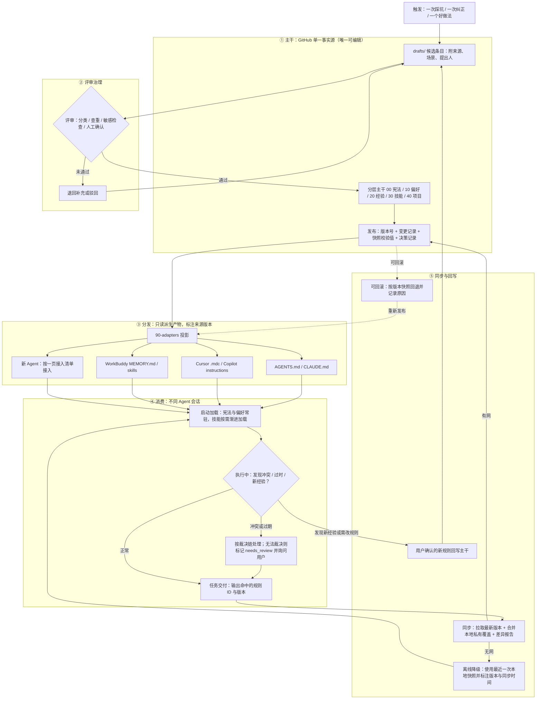
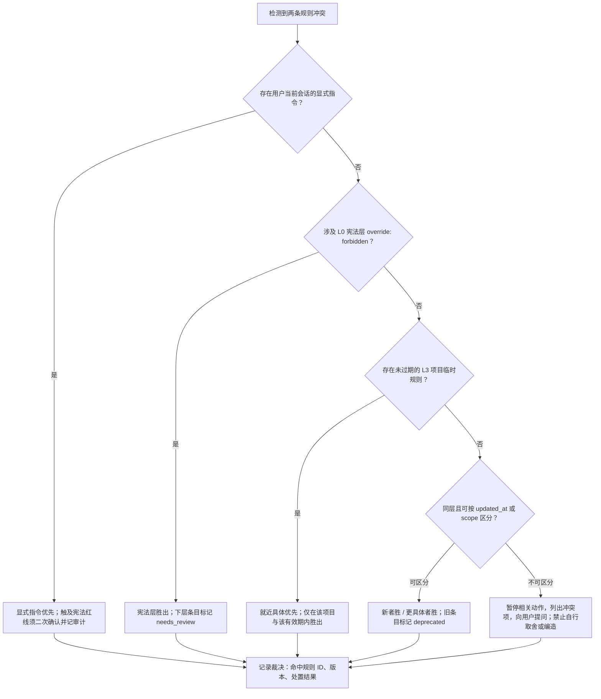

# 01 · PRD：个人 Agent 规则中枢（agent_rules_hub）

> 阶段：策划方案 / 产品侧 PRD + 轻量生态调研。**不含技术选型与代码实现**，架构设计由架构师高见远在下一阶段完成。
> 撰写：产品经理 许清楚（Xu）｜全文简体中文

---

## 0. 项目信息与边界

| 项 | 内容 |
| --- | --- |
| Language | 简体中文（与用户语言一致） |
| Project Name | `agent_rules_hub`（snake_case；仓库目录沿用主理人已建的 `agent-rules-hub`） |
| 文档编号 | `docs/01-PRD.md` |
| 运行环境前提 | 中文用户、Windows；日常使用 WorkBuddy（具备 `~/.workbuddy/skills`、用户级 `MEMORY.md`、工作区记忆、`mcp.json` 等机制）；当前工作区 `C:/Users/Hello World/WorkBuddy/My Memory`。**此段来源为主理人提供的背景前提，非联网核实结论** |
| Programming Language / 技术栈 | **本阶段不涉及**。用户诉求是内容资产与治理方案，不是软件功能开发，故不套用默认前端技术栈；由架构师后续确定 |
| 原始需求复述（原文照录，含笔误） | 「我该怎么沉淀自己使用AI Agent过程中的经验和偏好，以及技能，便于分享给不同的Agent，提升Agent完成任务时，对我的规则进行遵守，推荐的方式是讲这些经验、技能、Agent使用的偏好，技能可以放在Github上，供不同的agent调用，也可以同步更新这些使用规则和偏好」 |
| 用户倾向方案 | 把「经验 / 偏好 / 技能」沉淀到一个 GitHub 仓库作为**单一事实源**，供不同 Agent 调用，并支持同步更新 |

### 0.1 核心痛点（问题重述）

用户的痛点**不是"存起来"**，而是三件事：

1. **稳定遵守**：不同 Agent 在做任务时，能一致地按"我的规则"行事，而不是每次重新交代、或各工具各理解一套。
2. **同步生效**：规则更新后，所有已接入的 Agent 自动跟上，**不产生多份互相矛盾的副本**（这正是 VS Code 官方文档对多 harness 场景的明确告诫："keep shared requirements consistent and avoid contradictory copies" [S2]）。
3. **可持续维护**：规则会越攒越多，若不治理，会像追加式日志一样"只增不改、越写越不可信" [S25]。

因此本产品的本质是 **一套带治理机制的规则资产库**，而不是一个文件夹或一份大号 prompt。

### 0.2 本 PRD 不包含

具体仓库技术选型、同步脚本、CI、加密方案、MCP Server 实现、各 Agent 的具体配置命令——均留给架构师。本文只定义**产品行为、资产模型、信息架构、验收标准与裁决规则**。

---

## 1. 生态调研：主流 Agent 的规则 / 技能 / 记忆承载方式

### 1.1 对比表

> 核实状态见 1.2 来源清单。表中标注「第三方」的事实来自社区资料而非官方文档，已在"主要局限"或来源清单中明示。

| 方案 | 承载内容类型 | 加载时机与触发方式 | 跨 Agent 复用能力 | 版本 / 同步能力 | 主要局限 | 来源 |
| --- | --- | --- | --- | --- | --- | --- |
| **AGENTS.md 开放规范** | 项目/团队的常驻指令：构建与测试命令、代码约定、PR 规范、安全注意事项 | 会话启动时按目录树自上而下拼接加载；**离被编辑文件最近的 AGENTS.md 优先**；显式用户 prompt 覆盖一切；纯 Markdown、无必需字段 | **最强（跨 Agent 最低公分母）**：一个文件被 Codex、Cursor、Copilot、Gemini CLI、Jules、Devin、Windsurf、VS Code 等直接识别；官方称已被 6 万+ 开源项目采用，由 Linux 基金会旗下 Agentic AI Foundation 托管 | 随仓库 Git 版本化；可嵌套、可原地更新；第三方整理提到 `AGENTS.override.md` 覆盖机制与 Codex 32 KiB 拼接上限 | 常驻注入，太长会占上下文；只解决"成文指令"，不解决按需加载技能、不含审批/审计/过期治理；嵌套多文件时人不易看清最终生效集合 | [S1][S2][S3] |
| **Claude Code：CLAUDE.md + Agent Skills(SKILL.md)** | CLAUDE.md = 每次会话都要知道的事实与规则；Skills = 一个任务的可复用 SOP（可含脚本/模板/参考资料）；另有 `.claude/rules/` 分主题规则、auto memory、Hooks | CLAUDE.md 常驻（支持 `@` 引用其他文件）；Skills 采用**渐进式披露**：启动只加载每个技能的 name + description（约百 token 级），任务匹配时才读入完整 SKILL.md，再按需读附属文件；`.claude/rules/` 用 `paths` 限定；Hooks 由应用强制而非模型自觉 | Skills 已被 Anthropic 发布为**开放标准**，同一份技能目录可在 Claude Code、Codex、Cursor 等多款兼容产品间复用；用户级 `~/.claude/skills/` 跨项目、项目级 `.claude/skills/` 可提交共享 | 项目级文件随 Git 共享；**用户级 CLAUDE.md 与 auto memory 是本地的，不通过 Git 同步**；新版 Claude Code 在项目无 CLAUDE.md 时可读 AGENTS.md | 多套机制并存易放错位置；`/doctor prompt-audit` 之所以存在，正是因为官方也发现文件会过时、引用失效、**互相矛盾**；用户级内容天然形成"每人一份副本" | [S4][S5][S6][S7] |
| **Cursor Rules（`.cursor/rules/*.mdc`）** | 项目约定、领域知识、风格与架构约束、专用流程 | 四种触发：`alwaysApply: true` 常驻 / 依 `description` 由 Agent 判断相关性 / `globs` 匹配文件时自动附加 / 对话中 `@规则名` 手动调用；规则内容置于模型上下文开头 | 仅 Cursor 生态；另有 User Rules（全局）、Team Rules（控制台下发）、并支持 AGENTS.md 作为简化替代 | `.mdc` 随仓库版本控制、可团队共享；User Rules / Team Rules 不走仓库 | 必须用 `.mdc` + frontmatter，纯 `.md` 会被忽略；格式与其他 Agent 不通用；`@file` 只是指引 Agent 去读，不内联内容 | [S8][S9] |
| **GitHub Copilot 指令文件** | 全仓编码规范、语言/路径专属规范、组织级基线、可复用的 prompt 文件 | `.github/copilot-instructions.md` 全工作区常驻；`.github/instructions/*.instructions.md` 用 `applyTo` glob 按文件匹配，或按 `description` 语义匹配；也有用户级与**组织级**指令 | 中等：官方同时识别 AGENTS.md 与 CLAUDE.md；VS Code 中不同 harness 各认各的格式，官方文档建议多 harness 时选用共享格式以免出现相互矛盾的副本 | 随仓库版本控制；组织级指令可跨仓库统一下发；用户级目录**不随 Settings Sync 漫游** | 自定义指令不作用于行内补全；文件类型多、位置分散；组织级能力有订阅门槛 | [S2][S10][S11] |
| **WorkBuddy：Skills / MEMORY.md / mcp.json** | 三层记忆（云端长期画像 / 用户级本地 MEMORY.md / 工作区记忆含每日日志）、用户级与项目级 Skills、MCP 外部工具配置、身份三件套 | 云端画像与用户级 MEMORY.md 跨项目常驻注入；工作区记忆仅本项目；每日日期日志为**只追加**；Skills 以关键词或 `@skill:` 触发；`mcp.json` 在启用对应服务时生效 | 中等：Skills 采用 `SKILL.md` 生态格式，用户级跨项目、项目级仅本项目；`mcp.json` 分用户级与项目级 | 文件均为纯文本（Markdown / JSON / YAML），随文件系统存在；本地机制本身**不提供跨设备 Git 同步**；目录内已有 `audit-log/`、`file-history/` 等追溯性文件 | **本节机制描述来自第三方教程与社区拆解，非官方文档，未经官方核实**，实施前需在本机实测确认；云端画像本地缓存手改会被下次同步覆盖；日志只增不改、易失真；优先级为「会话上下文 > 工作区 > 用户级 > 云端」，多层叠加时人难判断最终生效项 | [S21][S22][S23][S24][S26]；并与主理人背景前提一致 |
| **MCP（Model Context Protocol）** | 不是规则文件，而是**连接协议**：暴露 tools（可调用函数）、resources（数据/文档）、prompts（提示模板） | Agent（host）通过 client 连接 server，先列出能力再按需调用；官方类比「AI 应用的 USB-C」 | **强（连接层）**：Claude、ChatGPT、Cursor、VS Code、Copilot 等广泛支持，一次接入多端可用 | 协议本身不管内容版本；规范持续演进（2026-07-28 转为无状态架构，第三方资料 [S17 之外的补充见 1.2 注]）；由 2025-12 起归 Linux 基金会 AAIF | 解决"如何连到外部数据/工具"，**不解决**"规则由谁审定、如何版本化、如何同步、如何裁决冲突"；工具描述由不可信 server 提供，需 host 做授权与审批 | [S12][S13][S14] |
| **dotfiles 式规则仓库** | 任何纯文本配置：shell / 编辑器 / 工具配置，以及本方案拟沉淀的规则资产 | 靠 symlink 或 bootstrap 安装脚本把仓库文件落到目标位置；下次会话或重新 source 时生效 | 与 Agent 无关，是**通用的个人配置单一事实源范式** | **范式最贴合诉求**：Git 天然提供单一事实源、版本控制、易恢复、跨设备同步、diff/回滚；敏感信息用 `.gitignore` / `.local` / 加密 secrets 分离；工具链有 Git bare repo、GNU Stow、chezmoi、yadm、Dotbot | 需要安装脚本与软链接这层间接关系；首次 checkout 可能与已有文件冲突；**不提供内容治理**（谁审、何时过期、谁优先）；资料均为实践类文章，属经验性总结 | [S18][S19][S20] |
| **记忆服务（mem0 类）** | 从对话中自动抽取的**动态**用户事实与偏好、历史决策、失败过的做法 | 每次会话前按语义检索相关记忆并注入上下文；可多 agent 共享同一 `user_id` 空间 | 强（作为共享记忆层，多 Agent 读写），但需应用侧集成 SDK / 自托管服务 | 记忆条目可更新，新偏好可在检索时覆盖旧条目；每次读写可记录日志、可审计；支持自托管 / K8s / 隔离网部署 | **不是成文规则**：无人工评审、无显式版本与回滚、无公开分享，且低质量记忆会污染检索、检索增加延迟；官方亦提示隐私敏感场景需提供删除与导出。与规则仓库**互补而非替代** | [S15][S16][S17] |

### 1.2 关键事实与来源清单（含核实状态）

> 以下链接均为本次联网检索所得真实结果；未做任何虚构。**标注「第三方」或「二手」的条目不作为官方结论引用**。

**官方 / 机构来源（已联网核实）**

- [S1] AGENTS.md 官方站 — https://agents.md/ ：开放格式、6 万+ 开源项目、纯 Markdown 无必需字段、就近优先、显式用户 prompt 覆盖一切、由 Linux 基金会旗下 Agentic AI Foundation 托管、支持嵌套。
- [S2] VS Code 官方文档「Use custom instructions」 — https://code.visualstudio.com/docs/copilot/customization/custom-instructions ：各 harness（Copilot / Claude / Codex）支持的指令格式；AGENTS.md 为跨 Agent 共享格式；明确建议"keep shared requirements consistent and **avoid contradictory copies**"；用户级目录不随 Settings Sync 漫游。
- [S4] Anthropic 工程博客 — https://www.anthropic.com/engineering/equipping-agents-for-the-real-world-with-agent-skills ：Agent Skills 已发布为**开放标准**；SKILL.md 必需 YAML frontmatter（name + description）；渐进式披露三层；可捆绑脚本与参考文件。
- [S5] Agent Skills 开放标准站 — http://skill.md/ ：技能目录结构（`SKILL.md` + `scripts/` + `references/` + `assets/`）；"portable, version-controlled folders that agents load on demand"；"Build a skill once and use it across any skills-compatible agent"。
- [S8] Cursor 官方 Rules 文档 — https://cursor.com/docs/rules ：四类规则；`.mdc` 强制扩展名；frontmatter 三字段 `description` / `globs` / `alwaysApply`；四种应用方式；规则内容置于上下文开头；`@file` 不内联。
- [S10] GitHub Docs — https://docs.github.com/en/copilot/how-tos/configure-custom-instructions/add-repository-instructions ：`.github/copilot-instructions.md`、`.github/instructions/*.instructions.md`、组织级指令、用户级全局文件。
- [S11] Microsoft Learn — https://learn.microsoft.com/en-au/training/modules/configure-customize-github-copilot-visual-studio-code/3-customize-copilot-responses-instruction-files/ ：`applyTo` glob、frontmatter 字段（`applyTo` / `description` / `name`）、组织级跨仓库下发。
- [S12] MCP 官方站 — https://modelcontextprotocol.io/ ：开源标准，连接数据源 / 工具 / 工作流，"USB-C for AI applications"。
- [S14] 法国竞争管理局《AI agents 行业竞争意见》（机构文件） — https://www.autoritedelaconcurrence.fr/sites/default/files/commitments/2026-09/26a05_eng.pdf ：MCP 由 Anthropic 发起、Apache 2.0、2025 年底归入 Linux 基金会 AAIF；host / client / server 三角色；tools / resources / prompts 三类能力。
- [S15] Mem0 官网 — https://mem0.ai/ ：跨 session 与跨 agent 的持久记忆、`user_id` 隔离、自动抽取与语义检索、"Every read and write logged" 可审计、支持自托管 / 私有云 / 隔离网。
- [S16] Mem0 官方博客 — https://mem0.ai/blog/how-memory-works-in-ai-chatbots ：记忆适合稳定偏好与重复任务；**用户明确改变偏好时，新信息可在检索时覆盖旧条目**；多 Agent 可作为共享记忆层；隐私敏感场景需提供删除与导出。

**第三方 / 社区 / 二手资料（经验性，非官方结论）**

- [S3] 第三方整理的 AGENTS.md 规范 — https://github.com/tdimino/claude-code-minoan/blob/HEAD/skills/core-development/agents-md-manager/references/agents-md-spec.md ：`AGENTS.override.md` 覆盖机制、Codex 32 KiB 拼接上限、fallback 文件名。**第三方整理，非官方规范原文**。
- [S6] Open Skills 指南 — http://openskills.app/guides/what-are-claude-skills ：开放标准发布于 agentskills.io；`name` 小写连字符 ≤64 字符、`description` ≤1024 字符、元数据约 100 tokens / 技能；`~/.claude/skills/` 与 `.claude/skills/` 区别。**第三方**。
- [S7] CLAUDE.md 实践指南 — https://signalovernoise.at/guides/setting-up-your-first-claude-md-file/ ：CLAUDE.md 建议 < 200 行、`@import`、`.claude/rules/` 的 `paths`、auto memory 位于 `~/.claude/projects/<p>/memory/MEMORY.md` 且每次会话加载前 200 行 / 25 KB 且**不通过 Git 共享**、Hooks 由应用强制、`/doctor prompt-audit` 可检出过时与互相矛盾的文件。该文自述引用 Anthropic 官方 memory / skills 文档并标注核对于 2026-10-26，**本文未逐条核对官方原文，按二手资料使用**。
- [S9] Cursor 中文社区文档 — https://effective-cursor.vercel.app/zh/docs/3-cursor-rules/how-rules-work ：交叉印证 frontmatter 三字段与四种应用方式。**第三方**。
- [S13] Wikipedia（Wikiwand 镜像） — https://www.wikiwand.com/en/map/Model_Context_Protocol ：MCP 于 2024-11-25 由 Anthropic 发布、2025-12 捐给 AAIF、同期发布 Agent Skills 开放标准。**百科二手**。
- [S17] 第三方 Mem0 资料 — https://tokrepo.com/en/workflows/b61fca8c-edd9-4ffa-bdc3-f21ce6715af9 ：Apache 2.0、5.1 万+ stars、常见坑（低质量记忆污染检索、检索延迟、需删除/导出能力）。**第三方**；另检索到第三方技术站提到 MCP 2026-07-28 无状态修订，因未获官方规范页逐条核实，**本文只作背景、不引用其版本细节**。
- [S18][S19][S20] dotfiles 实践文章 — https://blog.hankmo.com/how-geeks-manage-dotfiles 、https://codeloomdevv.co.in/blog/productivity/dotfiles-management 、https://kokil.com.np/blog/manage-dotfiles-and-server-config-with-git ：单一事实源、版本控制、易恢复、symlink + `install.sh` / bootstrap、GNU Stow / chezmoi / bare repo / yadm / Dotbot、`.local` 与 `.gitignore` 分离敏感信息、按机器分支或本地覆盖文件。**均为经验性实践文章，非规范**。
- [S21][S22][S23][S24][S26] WorkBuddy 第三方教程与社区拆解 — https://www.xiangtianchi.com/Web/CourseDetail?id=1187 、https://www.toutiao.com/article/7682781416718877199/ 、https://www.shangyexinzhi.com/article/34377229.html 、http://mp.weixin.qq.com/s?__biz=MzI2OTIyNjEyMQ==&mid=2247484549&idx=1&sn=ea7d388e10843b5dc2a5981bf81f948d 、https://ottermind.ai/zh-CN/skills/ai-brain-learning-memory ：三层记忆与优先级、`~/.workbuddy/MEMORY.md`、工作区 `.workbuddy/memory/`（MEMORY.md + 只追加日期日志）、`~/.workbuddy/skills/<name>/SKILL.md` 与项目级技能、`~/.workbuddy/mcp.json` 与项目级 `mcp.json`、身份三件套、`audit-log/` 与 `file-history/`、纯文本承载、记忆分级限额。**全部为第三方教程 / 自媒体，非 WorkBuddy 官方文档，未经官方核实**；与主理人提供的背景前提一致，但建议架构师实施前在本机 `~/.workbuddy` 实测确认路径与优先级。
- [S25] Anthropic「Dreaming」记忆架构（腾讯快报二手转载） — https://kuaibao.qq.com/s/20261108A067YB00 ：四层记忆（Transcript / MemoryNotes / Wiki 式 MemoryRepresentations / InjectedContext）、Verify → Enrich → Organize、**先怀疑旧记忆再添加新事实**、合并重复知识、只读挂载、"追加式记忆会随时间单调变差"。**二手转载，未逐条核对官方 Cookbook 原文，仅作设计启发**。

> **未核实声明**：WorkBuddy 各项机制、dotfiles 实践细节、Claude Code 的部分参数（200 行 / 25 KB / 32 KiB）、mem0 的 stars 数，均属第三方或经验性资料，未在官方文档逐条核实；本文未编造任何事实或链接。若某工具在后续阶段不可用或查不到，架构师应以本机实测为准。

### 1.3 调研结论：对本方案的 6 条启示

1. **收敛到两个开放标准，而不是给每个 Agent 各写一套。** AGENTS.md 是跨 Agent 的"最低公分母"（[S1][S2] 均确认多 harness 支持），Agent Skills(SKILL.md) 是首个被多家产品接受的技能开放标准（[S4][S5]）。主干内容应优先投影成这两类，其余 Agent 专属文件作为补充视图。
2. **必须区分「常驻约束」与「按需加载」。** 常驻文件越长越难被稳定遵守（[S7] 建议 CLAUDE.md < 200 行），而 Skills 的渐进式披露让"内容可以很多、上下文占用很小"（[S4]）。因此：宪法与偏好必须**短且常驻**，经验与技能放在**按需层**，这是"稳定遵守"与"可持续积累"能同时成立的前提。
3. **"就近优先 + 显式指令覆盖一切"已是行业共识，直接沿用即可。** AGENTS.md 官方规则 [S1]、WorkBuddy 记忆优先级 [S21]、Cursor `globs` [S8] 与 Copilot `applyTo` [S11] 都指向同一套作用域逻辑。本方案不自创裁决哲学，只把它写成可执行的成文规则（见 6.2）。
4. **纯 Git 仓库天然满足"版本 / 回滚 / 审计 / 离线 / 同步"，无需另建存储。** dotfiles 范式已把单一事实源、版本控制、跨设备恢复、敏感信息分离跑通多年 [S18][S19][S20]；WorkBuddy 自身也以纯文本 Markdown / JSON / YAML 承载记忆与技能，并配有追溯性文件 [S23]。**用 GitHub 仓库作事实源与用户倾向完全一致，是可行的。**
5. **最大风险不是丢失，而是"失真与无序"。** 追加式记忆只增不改会单调变差 [S25]；mem0 亦指出低质量记忆污染检索、需让新偏好覆盖旧条目 [S16][S17]；Claude Code 甚至专门提供检出"互相矛盾文件"的审计命令 [S7]。所以必须内置 **查重合并 + 过期复核 + 运行时只读 + 显式裁决链**，否则仓库会越写越不可信——这正是用户"不产生多份互相矛盾副本"的深层诉求。
6. **MCP 与记忆服务是互补件，不是替代品。** MCP 管"Agent 如何连到外部工具与数据" [S12][S14]，mem0 管"跨会话的动态事实" [S15][S16]，二者都不天然提供"人工审定、版本化、可回滚、可公开分享"的成文规则。本方案应以规则仓库为主干；动态记忆与工具连接作为旁路，**动态记忆不得自动写入主干**（对应 R19）。

---

## 2. 产品定义

### 2.1 Product Goals（3 个正交目标）

| 编号 | 目标 | 衡量口径 |
| --- | --- | --- |
| **G1 · 一致性** | 任一时刻，所有已接入 Agent 遵守的是**同一版本、互不矛盾**的规则集合 | 随机抽取 3 个已接入 Agent，对同一组冲突用例的处理结果一致；仓库内不存在两条正文重复的生效规则 |
| **G2 · 低摩擦沉淀** | 从「一次踩坑 / 一次纠正」到「全 Agent 生效」只需**一次录入 + 一次确认**，零重复维护 | 新增一条规则不产生任何逐 Agent 的手工编辑；接入一个新 Agent 无需改动主干正文 |
| **G3 · 可治理** | 每一次规则变更可追溯、可评审、可回滚，且私有与公开内容天然隔离 | 任一条规则可反查决策记录与历次版本；任一发布可一键回退；敏感内容 100% 不进入公开发布物 |

### 2.2 User Stories（8 条）

| # | 用户故事 |
| --- | --- |
| US1 | 作为**规则的主人（我）**，我希望在一次踩坑后只写一次就能让所有 Agent 都记住，以便不用在每个工具里重复交代同一句话。 |
| US2 | 作为**同时使用多个 Agent 的人**，我希望换用新 Agent 时用极少的步骤接入我现有的全部规则，以便不改变工作习惯、也不从零"调教"。 |
| US3 | 作为**对一致性敏感的使用者**，我希望规则更新后所有 Agent 自动同步到同一版本，以便不会出现「A 工具按旧规则、B 工具按新规则」的矛盾结果。 |
| US4 | 作为**重视隐私的使用者**，我希望私有偏好、项目信息、客户数据与可公开分享的技能自动隔离，以便放心把仓库分享给别人而不泄露敏感内容。 |
| US5 | 作为**需要复盘的使用者**，我希望查到某条规则是谁、何时、依据什么加的，并能一键回退，以便规则写错或过时的时候快速止损。 |
| US6 | 作为**经常出差 / 网络不稳的使用者**，我希望断网时 Agent 仍能按最近一次同步的规则工作、并明确告知所用版本，以便不中断任务、也不会被静默套用过期规则。 |
| US7 | 作为**愿意分享的经验贡献者**，我希望把验证过的做法打包成符合开放标准的技能，供他人和其他 Agent 直接复用，以便经验产生复利而不是只躺在笔记里。 |
| US8 | 作为**正在执行任务的 Agent**，我希望启动时就拿到一份最小必要且无冲突的规则集合（宪法与偏好常驻、技能按需加载），以便稳定遵守规则又不浪费上下文。 |

---

## 3. 三类资产的定义与分层模型

### 3.1 三类资产定义

> 「三类资产」回答的是**内容是什么（what）**；「四层模型」回答的是**何时生效、强度多高（when / how strong）**。两者正交，不可混为一谈。

| 资产 | 定义 | 典型形态 | 判断口诀 | 是否参与约束裁决 |
| --- | --- | --- | --- | --- |
| **经验 Experience** | 从真实任务中验证过的**事实性知识 / 踩坑结论**，回答「什么情况下会发生什么、该避开什么」 | 一条一文件；含「场景 + 结论 + 依据 + 失效条件」；可附来源链接（必须真实，查不到标注未核实） | 去掉它，Agent 会**再踩一次坑** | **否**（作为参考信息，不直接当硬约束）；与偏好冲突时视为"需要复核"的信号 |
| **偏好 Preference** | 我要求 Agent **稳定遵守**的规则与习惯，回答「不管做什么都要 / 不要怎样」 | 短句、祈使语气、常驻加载；数量受控 | 去掉它，Agent 的**输出风格或行为**就不像我想要的 | **是**（约束型，参与 6.2 裁决链） |
| **技能 Skill** | 可复用的**操作流程 / SOP**，回答「遇到某类任务按什么步骤做」 | 一个目录 + `SKILL.md`（name + description + 步骤 + 验收），可附模板 / 检查清单 / 参考文件；按需渐进加载 | 去掉它，同类任务要**重新摸索一遍流程** | **否**（程序型，仅在被激活的任务内生效，且不得与约束层冲突） |

**真实例子（各 3 条）**

| 经验 | 偏好 | 技能 |
| --- | --- | --- |
| WorkBuddy 云端画像的本地缓存手改会被下次同步覆盖，不要直接改缓存文件 [S21][S23] | 所有输出用简体中文，结构化（表格 / 分级标题 / Mermaid），不写空话套话 | 周报生成：读取近 7 天日志 → 按「完成 / 风险 / 计划」分组 → 每条带可量化结果 → 输出 Markdown |
| AGENTS.md 中离被编辑文件最近的那个文件优先，显式用户指令覆盖一切 [S1] | 严禁编造事实或来源链接；查不到就明确标注「未经核实 / 经验判断」 | 生态调研对比表：生成关键词组 → 检索 → 去重 → 交叉印证 → 附来源链接与核实状态 |
| 追加式日志只增不改会随时间失真，需定期校验与合并 [S25] | 不确定时先列澄清问题再动手；破坏性操作先出计划并二次确认 | PRD 撰写：项目信息 → 目标 → 用户故事 → 需求池（含验收标准）→ 信息架构 → 流程图 → 待确认问题 |

**资产流转规则（关键设计）**：经验是**修订输入**，不是运行时约束。当一条经验被反复验证、需要"强制执行"时，应**晋升**为 L0 / L1 的偏好条款，并在决策记录中保留 `supersedes` 关系，同时把原经验标记为已被引用而非复制正文。这样既避免了"经验越攒越多却没人遵守"，也避免了"同一句话在主干里出现两遍"。

### 3.2 分层模型

> 层号沿用主理人给定的四层顺序；**冲突优先级不按层号排序**，实际裁决顺序见 3.2 表末列与 6.2。

| 层 | 名称 | 承载资产 | 真实例子（2-3 条） | 变更频率 | 冲突优先级 |
| --- | --- | --- | --- | --- | --- |
| **L0** | 不可违背的宪法层 | 偏好（硬约束）+ 少量由经验晋升而来的红线 | ① 所有输出用简体中文且结构化；② 严禁编造事实与来源链接，查不到必须标注未核实；③ 密钥 / token / 客户数据不得写入任何公开物，破坏性操作须二次确认 | **极低**：季度至年级，几乎不动；变更必须评审 + 决策记录 + 显式确认 | **① 最高**；`override: forbidden` 条目不可被任何自动规则覆盖 |
| **L1** | 稳定偏好层 | 偏好（跨 Agent、跨项目通用习惯） | ① 文档优先用表格 / Mermaid，避免空话套话；② 报告默认同时给可读正文与可交付文件；③ 不确定时先列澄清问题，不自行假设 | **低**：月度，随习惯演化 | **③**（低于 L0 与 L3） |
| **L2** | 领域技能层 | 技能（可复用 SOP） | ① 周报生成；② 生态调研对比表；③ PRD 撰写 / 文件批量整理 | **中**：周至月，随流程迭代 | **不参与覆盖裁决**：仅被激活时在该任务内作为执行程序；若其步骤与 L0 / L1 / L3 冲突，判该技能需修订 |
| **L3** | 项目临时层 | 项目专属例外偏好 + 项目专属经验 | ① 某客户项目要求交付物用繁体中文（例外于 L0 的简体中文，需显式确认）；② 某项目禁止联网检索，只用本地资料；③ 某项目文件命名必须用拼音 | **高**：天至周，项目结束即归档 / 失效 | **② 就近具体优先**，仅在 `expires` 有效期内、且仅在该项目范围生效 |
| **知识区**（非生效层） | 经验区 | 经验（事实性知识） | 见 3.1 经验列 | **中**：随任务持续产生，需定期复核 | **不参与**：仅作参考；两条经验矛盾或与约束层冲突 → 标记 `needs_review` 并询问用户 |

**优先级速记**：用户当前会话显式指令（第 0 优先级）> L0 宪法 > L3 项目临时（有效期内）> L1 稳定偏好 >（L2 技能 / 经验区不参与覆盖比较）。

### 3.3 资产与层的关系（正交说明）

- 一条**偏好**可落在 L0（硬约束）、L1（通用习惯）或 L3（项目例外），取决于强制程度与作用域。
- 一条**技能**固定落在 L2，靠 `applies_when` 描述触发条件，对应 Skills 的 `description`、Cursor 的 `globs`、Copilot 的 `applyTo` [S4][S8][S11]。
- 一条**经验**落在知识区；它要"变成规矩"必须走晋升流程，不能悄悄改写成偏好正文的复制品。
- `scope` + `applies_when` + `expires` 三个元数据共同决定"就近具体优先"如何被机器判定，是 6.2 裁决链可执行的基础。

---

## 4. 需求池（P0 / P1 / P2）

### 4.1 产品约束清单（7 项，映射到需求 ID）

| 约束 | 含义 | 对应需求 |
| --- | --- | --- |
| C1 单一事实源 | 所有可编辑规则只存在于主干一处 | R01、R04 |
| C2 零重复维护 | 一次修改、全 Agent 生效；不逐份编辑、不复制正文 | R01、R04、R09、R16 |
| C3 可追溯可回滚 | 任一状态可反查来源、可一键退回稳定版本 | R06、R07、R08 |
| C4 私有 / 敏感信息与公开内容隔离 | 敏感内容默认不进入任何公开物 | R02、R05、R16 |
| C5 离线或无网时的降级 | 断网仍可工作，且显式告知版本陈旧 | R11、R15 |
| C6 规则变更可审计 | 谁、何时、依据什么、谁确认、影响哪些 Agent | R06、R08、R13 |
| C7 新 Agent 接入成本低 | 接入不改主干、步骤极少、可验证生效 | R03、R12、R17 |

### 4.2 需求池表

> 优先级：**P0 = 必须有**（首版即需），**P1 = 应该有**，**P2 = 可以有**。验收标准均为可检验条件。

| ID | 需求 | 优先级 | 验收标准 | 关联约束 |
| --- | --- | --- | --- | --- |
| **R01** | 建立分层主干目录作为唯一事实源 | **P0** | 所有可编辑规则正文仅存在于 `00/`~`40/`；全仓检索任一规则只命中 1 个可编辑正文，其余命中项均带「派生产物 / 只读」标记 | C1、C2 |
| **R02** | 统一元数据字段 | **P0** | 主干条目 100% 含 4.4 所列必填字段；缺任一必填字段的条目**不予发布**并返回明确原因 | C4 |
| **R03** | 多 Agent 适配投影 | **P0** | 至少产出 5 类目标视图：AGENTS.md、CLAUDE.md、Cursor `*.mdc`、Copilot `copilot-instructions.md`、WorkBuddy `MEMORY.md` + `skills/`；在 ≥3 个不同 Agent 中，同一条 L0/L1 规则被实际加载并能列出验证方法 | C7 |
| **R04** | 派生产物只读 + 防重复维护 | **P0** | 每个派生产物头部标注来源版本与来源标识及「请勿手工编辑」；手工改动在下一次发布时被覆盖并告警；主干改 1 条 → 全部派生产物同步变更，**无需任何逐份编辑** | C1、C2 |
| **R05** | 私有 / 公开隔离与敏感阻断 | **P0** | 发布前检查命中敏感模式（密钥、token、身份信息、客户数据）即**阻断发布**；公开发布物中不含私有区内容；私有覆盖层只在本地合并且不被提交 | C4 |
| **R06** | 版本化发布 | **P0** | 每次变更生成唯一且可比较的版本号、变更记录、发布快照（各文件校验值）；任意一次发布可回答「改了哪几条 / 谁确认 / 影响哪些 Agent」 | C3、C6 |
| **R07** | 一键回滚 | **P0** | 可按版本快照回退到任一历史稳定版本并记录回滚原因；回滚后各 Agent 实际加载内容与目标版本完全一致 | C3 |
| **R08** | 决策记录（ADR） | **P0** | 每次新增 / 修订 / 废弃 / 晋升均生成决策记录，含提出人、时间、依据、评审结论；任一条规则可反查其决策记录与历次版本 | C3、C6 |
| **R09** | 评审入库流程 | **P0** | 候选条目先入 `drafts/`，经「分类 → 查重 → 敏感检查 → 人工确认」四步方可合入主干；**无人工确认不能进主干**；重复条目被合并为一条并保留来源引用，不并存 | C2 |
| **R10** | 可执行的冲突裁决规则 | **P0** | 裁决链写入治理文件并投影到每个 Agent 入口文件顶部；构造 3 组用例（会话指令 vs 宪法、项目临时 vs 稳定偏好、两条经验矛盾）时，Agent 处理结果与 6.2 一致，且无法裁决时会主动询问用户 | C1 |
| **R11** | 离线降级 | **P0** | 断网时 Agent 仍能加载最近一次成功同步的本地快照，并**显式提示所用版本与同步时间**；恢复网络后可一键同步并展示差异；禁止静默使用未标注的过期内容 | C5 |
| **R12** | 一页接入清单 | **P0** | 提供「该 Agent 认哪些文件 / 放在哪 / 如何验证生效」的一页清单；新增一个 Agent 的接入 **≤3 步且 0 改动主干正文** | C7 |
| **R13** | 规则命中反馈 | **P1** | 任务交付时可输出本次加载 / 命中的规则 ID 与版本清单，能定位「某条规则是否真的被遵守」 | C6 |
| **R14** | 过期与复核队列 | **P1** | `expires` 到期或长期未命中的条目自动不再作为强约束加载，并进入待复核列表；`status: deprecated` 的条目不参与加载 | C2 |
| **R15** | 增量同步与差异确认 | **P1** | 同步前展示差异清单，用户可逐条接受或拒绝；同步后报告「本地版本 → 主干版本」的变化 | C5 |
| **R16** | 三类资产统一模板 | **P1** | 经验 = 场景 + 结论 + 依据 + 失效条件；技能 = 触发条件 + 步骤 + 验收；偏好 = 单条祈使句 + 适用范围；新建条目模板填写率 100% | C2、C4 |
| **R17** | 接入状态自检 | **P1** | 可一键列出「已接入 Agent / 当前版本 / 是否与主干一致 / 上次同步时间」，不一致项被显式标红 | C7 |
| **R18** | 公开分享与订阅 | **P2** | 公开层可被独立克隆使用，含贡献指南与技能清单；他人复用技能无需改动自己的主干 | C7 |
| **R19** | 动态记忆与审定规则的边界 | **P2** | 产出边界文档，明确「运行时自动产生的动态事实」不得自动写入主干；如需成为规则，必须走 R09 评审流程 | C1 |
| **R20** | 规则效果度量 | **P2** | 可导出报表：各规则被命中 / 被覆盖 / 被用户纠正的次数，用于识别「写了但没用」的冗余条目 | C2 |

---

## 5. 信息架构设计稿

### 5.1 建议目录树（文本）

```text
agent-rules-hub/                          # GitHub 单一事实源仓库
├── README.md                             # 人类入口：这是什么 / 如何接入 / 如何贡献 / 分层速查
├── GOVERNANCE.md                         # 治理约定：分层定义、裁决链、评审与发布流程、变更权限
├── CHANGELOG.md                          # 人类可读变更记录（由发布过程生成，不手写）
├── manifest.yaml                         # 全局清单：仓库版本、发布时间、分层优先级表、条目索引
│
├── 00-constitution/                      # L0 宪法层：条数最少、不可自动覆盖
│   ├── CORE.md                           # 硬约束总纲（语言、结构化、不编造事实与链接）
│   └── SAFETY.md                         # 安全红线（敏感隔离、破坏性操作二次确认）
│
├── 10-preferences/                       # L1 稳定偏好层：跨 Agent / 跨项目通用习惯
│   ├── communication.md                  # 输出语言、结构化程度、语气、禁用套话
│   ├── formatting.md                     # 表格 / Mermaid / 文档形态等呈现习惯
│   └── workflow.md                       # 先计划后执行、验收标准、不确定先问
│
├── 20-experience/                        # 知识区：一条经验一文件（非运行时的约束层）
│   ├── EXP-0001-workbuddy-cloud-profile-overwrite.md
│   ├── EXP-0002-agents-md-nearest-wins.md
│   └── _index.md                         # 索引：按元数据聚合，标注状态（有效/已废弃/已合并）
│
├── 30-skills/                            # L2 领域技能层：一技能一目录，按需加载
│   ├── weekly-report/
│   │   ├── SKILL.md                      # 符合 Agent Skills 开放标准：name + description + 步骤
│   │   ├── references/                   # 可选：模板、示例、检查清单
│   │   └── CHANGELOG.md                  # 该技能自身变更历史
│   └── ecosystem-research/
│       └── SKILL.md
│
├── 40-projects/                          # L3 项目临时层：带过期时间，不进主干常驻发布
│   └── <project-name>/
│       ├── OVERRIDES.md                  # 仅该项目生效的例外规则，必须写明 expires 与理由
│       └── README.md                     # 为何需要例外、何时清理、由谁确认
│
├── drafts/                               # 候选区：未评审条目，不参与任何发布
│   └── <候选条目>.md
│
├── 90-adapters/                          # 分发适配层：只读派生产物（禁止手工编辑正文）
│   ├── AGENTS.md                         # 跨 Agent 通用指令视图
│   ├── CLAUDE.md                         # Claude Code 入口视图
│   ├── claude/rules/                     # Claude Code 分主题规则视图
│   ├── cursor/rules/*.mdc                # Cursor 规则视图（含触发元数据）
│   ├── copilot/copilot-instructions.md   # Copilot 入口视图
│   └── workbuddy/
│       ├── MEMORY.md                     # WorkBuddy 用户级记忆视图
│       └── skills/                       # WorkBuddy 技能视图
│
├── 99-private/                           # 私有区：不进入任何公开发布物
│   └── README.md                         # 私有内容如何本地覆盖、与公开内容的合并顺序
│
└── audit/                                # 审计与追溯
    ├── decisions/                        # ADR-xxxx：为何新增 / 修订 / 废弃 / 晋升某条规则
    └── releases/                         # 每次发布的快照清单：版本号 + 文件校验值 + 生效范围
```

> 说明：目录树只表达**产品级组织结构与职责**，不含脚本、命令、CI 配置或任何实现细节；命名与字段要求见 5.3 / 5.4。

### 5.2 各文件用途说明

| 路径 | 用途 | 可编辑性 |
| --- | --- | --- |
| `README.md` / `GOVERNANCE.md` | 人类入口与治理宪法；**裁决链必须同时写进 GOVERNANCE 并投影到各 Agent 入口顶部**，确保 Agent 也能读到 | 可编辑（主干） |
| `manifest.yaml` | 全局索引与版本锚点：当前发布版本、生效的分层优先级表、全部条目 ID 清单 | 可编辑（主干，随发布更新） |
| `00-constitution/` | 存放最少量、不可自动覆盖的硬约束；**新增条目需最高级别确认** | 可编辑（主干，评审最严） |
| `10-preferences/` | 存放跨项目通用习惯，按主题分文件，控制单文件长度以保证常驻遵守度 | 可编辑（主干） |
| `20-experience/` | 事实性知识库；是修订输入而非运行时约束；`_index.md` 供人快速浏览与发现重复 | 可编辑（主干） |
| `30-skills/*/SKILL.md` | 可复用 SOP；`description` 决定命中率，步骤含验收标准；附属资料按需加载 | 可编辑（主干） |
| `40-projects/*/OVERRIDES.md` | 项目例外，**必须带 `expires`**；过期自动失效并进入复核 | 可编辑（主干，临时） |
| `drafts/` | 未评审候选，隔离在主干之外，杜绝"顺手就写进正式规则" | 可编辑（不入发布） |
| `90-adapters/**` | 面向各 Agent 的**投影视图**，只负责"以对方认得的格式呈现同一份内容" | **只读派生产物** |
| `99-private/` | 私有覆盖层，本地合并，不提交、不公开 | 可编辑（本地，不入库） |
| `audit/decisions/` · `audit/releases/` | 决策记录与发布快照，支撑追溯、回滚与审计 | 由发布过程生成 |

### 5.3 命名规范（产品级要求）

1. 顶层目录使用**两位数字前缀**固定顺序与阅读优先级（`00` / `10` / `20` / `30` / `40` / `90` / `99`），新增分层不得打乱既有编号。
2. 经验条目：`EXP-<4位序号>-<kebab-case 短标题>.md`，序号一经分配不复用、不重排。
3. 技能目录：`<kebab-case 技能名>/SKILL.md`，目录名与 `SKILL.md` 内的 `name` 一致（对齐 Agent Skills 开放标准的约束 [S4][S6]）。
4. 项目目录：`<kebab-case 项目名>/`，例外文件固定为 `OVERRIDES.md`。
5. 决策记录：`ADR-<4位序号>-<短标题>.md`；发布快照：`audit/releases/<版本号>/`。
6. **派生产物文件名必须严格等于目标 Agent 约定的名字**（`AGENTS.md`、`CLAUDE.md`、`copilot-instructions.md`、`*.mdc`、`MEMORY.md`），不可自定义——这是"低接入成本"的前提。
7. 文件名统一使用小写 kebab-case，**禁用空格、中文与大写字母**（兼容 Windows 与跨平台）；版本号要求**单调递增、可比较、每次发布唯一**，具体格式由架构师确定。
8. 全局禁止"同一句话出现在两个可编辑文件"；确需跨层引用时只写 ID 引用，不复制正文。

### 5.4 元数据字段（产品级要求）

> 以下定义"必须记录哪些信息及其产品规则"，**不定义文件格式与实现**。

| 字段 | 含义 | 必填 | 产品规则 |
| --- | --- | --- | --- |
| `id` | 全局唯一稳定标识 | 是 | 一经分配不复用；用于命中反馈、审计、跨条目引用 |
| `layer` | L0 / L1 / L2 / L3 / experience | 是 | 决定加载时机与裁决层级 |
| `asset_type` | experience / preference / skill | 是 | 三类资产归类，决定模板与流转方式 |
| `source` | 来源：哪次任务 / 哪次纠正 / 外部链接 | 是 | 可追溯；外部链接必须真实，无法核实的标注「未经核实」 |
| `scope` | 适用范围：global / Agent 清单 / 项目清单 / 路径模式 | 是 | 判定"就近具体优先"的主要依据 |
| `applies_when` | 生效条件：任务类型、触发词、文件模式、时间段 | 否 | 对应 Skills `description`、Cursor `globs`、Copilot `applyTo` |
| `version` | 条目自身版本 | 是 | 与仓库发布版本区分，便于单条回溯 |
| `created_at` / `updated_at` | 双时态：记录时间 / 生效时间 | 是 | "新者胜"依据；防止把过期记忆当现行事实 |
| `expires` / `review_after` | 过期时间 / 复核时间 | 否（**L3 必填 expires**） | 过期不加载并进入待复核；长期未命中触发复核 |
| `priority` | 同层内优先级（数值越小越高） | 否 | 裁决链 tie-break，不能跨越层级 |
| `status` | draft / active / deprecated / superseded | 是 | **仅 active 参与加载** |
| `override` | allowed / forbidden | 否（**L0 必填**） | 标记 `forbidden` 者不可被任何自动规则覆盖 |
| `supersedes` / `superseded_by` | 晋升、合并、废弃关系 | 否 | 经验晋升为偏好时保留链路，杜绝正文复制 |
| `sensitivity` | public / private | 是 | 决定能否进入公开发布物；private 一律不公开 |
| `owner` / `approved_by` | 提出人 / 确认人 | 是 | 支撑评审与审计 |

### 5.5 主干与派生产物的产品规则（防止"多份矛盾副本"）

1. **主干唯一可编辑**：`00/`~`40/` 与 `drafts/` 是唯一可写入的内容区；`90-adapters/**` 全部为只读派生产物，头部标注「来源版本 / 来源标识 / 请勿手工编辑」。
2. **差异只在格式，不在内容**：跨 Agent 之间允许存在"文件名、frontmatter、分文件方式"的差异，**绝不允许存在"同一条规则的不同表述"**。
3. **手工改动必被覆盖并告警**：任何对派生产物的手工编辑在下一次发布时被覆盖；若某 Agent 确需特例，必须回到主干用 `scope` + `applies_when` 表达后重新投影，而不是改派生文件。
4. **私有层不进发布物**：`99-private/` 不提交、不公开；本地合并顺序固定为「主干 < 私有覆盖」，且私有层同样受 L0 宪法红线约束。
5. **运行时只读**：执行任务的 Agent 只能读取主干与派生产物，**不得直接改写**；任何新增 / 修订必须回到 `drafts/` 走评审流程。这一条是避免"越用越乱"的根本保障（呼应 [S25] 的只读挂载与"正在干活的 Agent 不适合当档案管理员"）。

---

## 6. 关键场景流程

### 6.1 闭环：沉淀 → 评审 → 发布 → 多 Agent 生效 → 更新 → 同步 / 回写



**闭环要点**

- 入口只有一个（`drafts/`），出口只有一个（一次版本化发布），中间不存在"Agent 顺手改规则"的旁路。
- ③ 的派生产物是**投影**，不是副本：主干改一次，五个视图同时变化（R04）。
- ⑤ 中"同步"是消费侧动作；用户确认的新规则通过 `W → D` 回到评审，**不会绕过评审直接发布**。
- 回滚 `X` 之后必须重新投影，保证所有 Agent 一起退回同一版本，避免出现版本错配。

### 6.2 规则冲突时的裁决（产品规则）

**裁决顺序表（从高到低）**

| 序 | 来源 | 说明 |
| --- | --- | --- |
| 0 | **用户当前会话的显式指令** | 覆盖一切；对齐 AGENTS.md 官方「explicit user chat prompts override everything」[S1] 与 WorkBuddy「会话上下文优先级最高」[S21]。但若触及 L0 红线，须二次确认并记入审计 |
| 1 | **L0 宪法层**（`override: forbidden`） | 不可被任何自动规则覆盖；下层冲突条目标记 `needs_review`，不删除、不禁默 |
| 2 | **L3 项目临时层**（`status: active` 且未过期） | 就近 / 具体优先；对齐 AGENTS.md「closest file wins」[S1]、Cursor `globs` [S8]、Copilot `applyTo` [S11]；过期即失效 |
| 3 | **L1 稳定偏好层** | 跨项目默认值，作为无更具体规则时的基线 |
| 4 | **L2 技能层 / 经验区** | 不参与覆盖比较：技能仅在被激活的任务内作为执行程序且不得违反 1~3；经验仅作参考。二者与约束层冲突时，判该条目需修订并询问用户 |

**六条不可违背的裁决原则**

1. **就近具体优先**：作用域越窄、离当前任务越近越优先；`scope` 与 `applies_when` 是唯一判定依据，不靠 Agent 主观猜测。
2. **新者胜 + 双时态**：同层同优先级冲突时，以 `updated_at` / 生效时间较新者为准，旧条目标记 `deprecated` 而非静默并存（借鉴 mem0 新偏好覆盖旧条目 [S16] 与"先怀疑旧记忆再添加新事实" [S25]）。
3. **过期即失效**：`expires` 到期或 `status` 为 `deprecated` / `superseded` 的条目不参与加载，并进入待复核队列。
4. **不自行猜测**：无法裁决时，Agent 必须**暂停相关动作、列出冲突项、向用户提问**；严禁自行挑一条、严禁编造规则（此为 L0 红线）。
5. **入库先查重合并**：新条目合入前必须查重，重复内容合并为一条并保留来源引用，不产生第二份正文（对齐 [S25] 的"Organize 合并重复知识"与 [S2] 的"avoid contradictory copies"）。
6. **裁决可追溯**：每次裁决（尤其是二次确认突破宪法）写入审计，附命中的规则 ID、版本与处置结果，可反查。



---

## 7. 待确认问题（需用户拍板）

| # | 开放项 | 为什么必须拍板 | 建议默认值（若用户无偏好） |
| --- | --- | --- | --- |
| **Q1** | **仓库公开范围**：全部私有 / 私有主干 + 公开技能子集 / 完全公开？若公开，哪些算敏感（工作项目名、内部术语、截图、客户信息是否一律私有）？ | 直接决定 `99-private/` 的边界、发布前的敏感检查强度，以及"分享给不同 Agent"是否能同时分享给他人 | 「私有主干 + 公开技能与通用偏好子集」，敏感清单从严 |
| **Q2** | **谁是评审人**：仅本人确认即发布，还是需要固定评审清单 / 二次确认？是否允许**低风险条目（如经验类）自动合入**？ | 决定 R09 流程强度与自动化边界；过严会不想用，过松会退化成追加式日志 | 偏好 / 宪法类必须人工确认；经验类可自动入 `drafts/` 但不自动生效 |
| **Q3** | **同步的产品行为**：手动同步 / 每次会话启动自动检查 / 定时自动同步？发现差异时是否允许 Agent 直接应用，还是必须逐条确认？ | 决定 R11 / R15 的交互强度，也决定"更新后能同步生效"的实际体感 | 会话启动自动检查并提示，**默认不自动应用**，需一次确认 |
| **Q4** | **首批接入的 Agent 清单与优先级**：WorkBuddy 必接之外，Claude Code / Cursor / Copilot / Codex 中先接哪 2-3 个？是否还有清单外的 Agent（如手机端远程指挥、云端 Agent）必须支持？ | 决定 `90-adapters/` 首版要做哪几类投影，也是 R03 / R12 验收范围的依据 | 首批：WorkBuddy + AGENTS.md 通用视图 + Claude Code（Skills 通用性最好） |
| **Q5** | **宪法层的强制力边界**：L0 是否需要"连用户显式指令也要二次确认才能突破"？若觉得太重，可降级为"仅记录审计即可"。 | 决定 Q1 优先级 0 与 1 的交互成本；是"稳定遵守"与"不被规则绑死"之间的取舍 | 保留二次确认，但仅限 3 条以内真正的红线（编造事实、敏感泄露、破坏性操作） |

---

## 8. 交付边界与交给架构师的输入

**本 PRD 已确定（架构师可直接作为约束）**：三类资产定义、四层分层与裁决优先级、7 项产品约束、20 条需求及验收标准、目录组织与元数据字段、主干与派生产物的只读关系、评审发布闭环、冲突裁决链。

**留给架构师决定（本文刻意不写）**：仓库私有/公开的具体实现、投影生成方式、同步机制与触发实现、敏感检查实现、离线快照的存储与校验、各 Agent 的具体配置路径与命令、版本格式、是否需要 MCP / 记忆服务作为旁路。

**需重点提醒架构师的两点风险**：

1. WorkBuddy 的机制描述来自第三方教程与社区拆解 [S21]~[S24][S26]，**非官方文档，未经官方核实**；实施前请在本机 `~/.workbuddy` 实测确认路径、优先级与 `mcp.json` 行为。
2. 生态中"就近优先 + 显式指令覆盖一切" [S1]、"避免矛盾副本" [S2]、"追加式记忆会失真" [S25] 是三条已被反复印证的规律，方案设计不应与之相悖。

---

*本文件为产品侧策划方案，事实性内容均附来源与核实状态；未核实项已明确标注，无编造事实或链接。*
