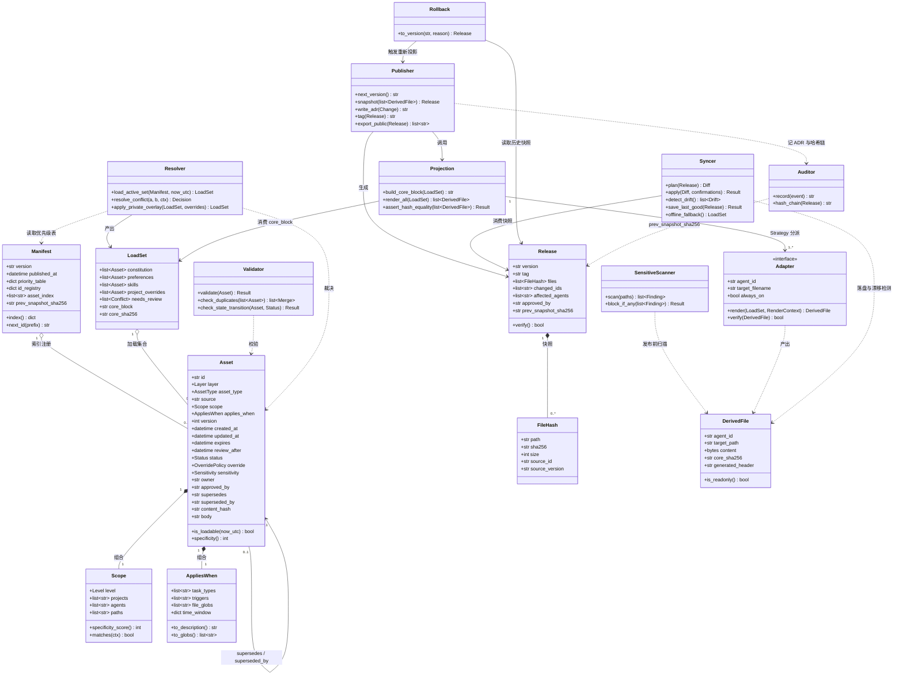
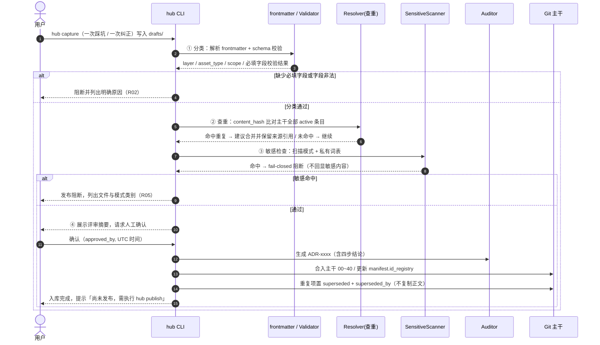
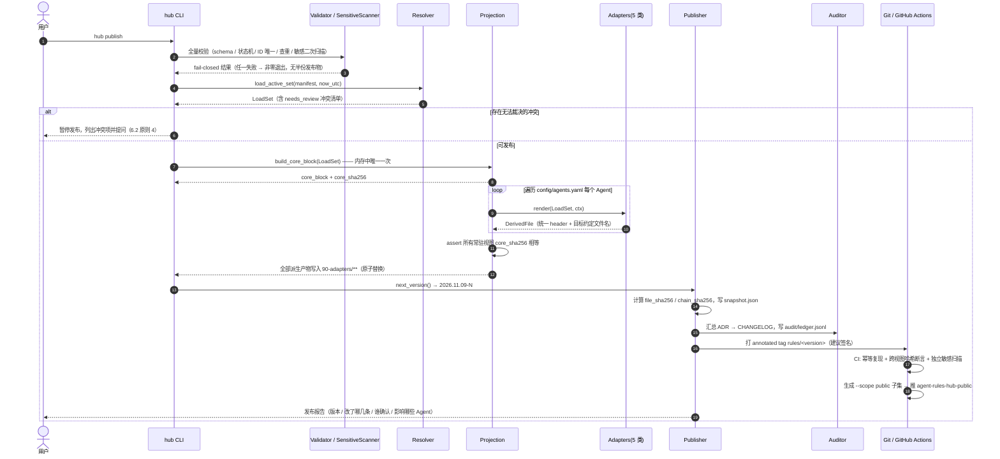
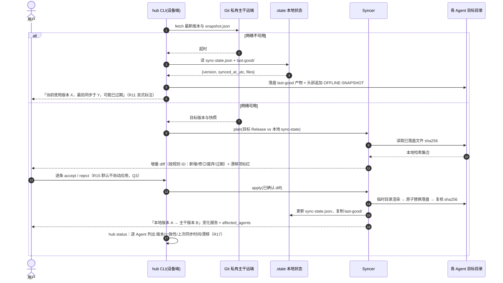
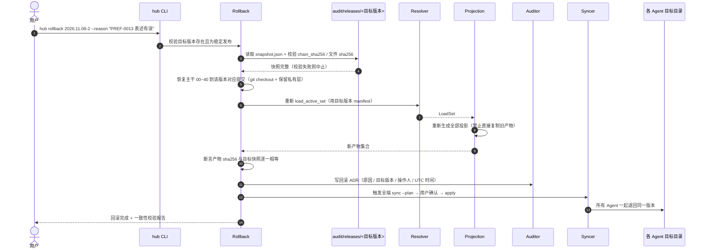
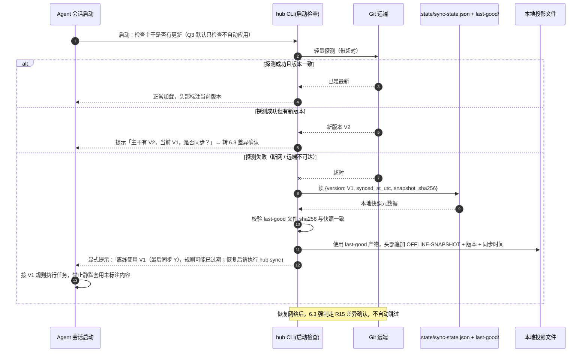
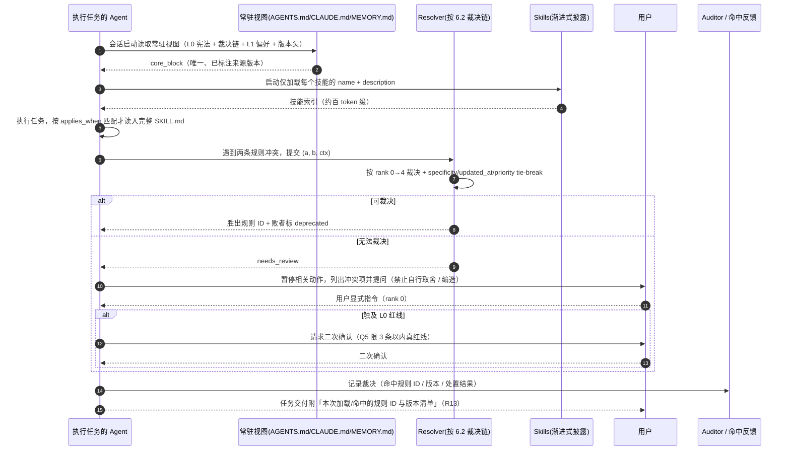
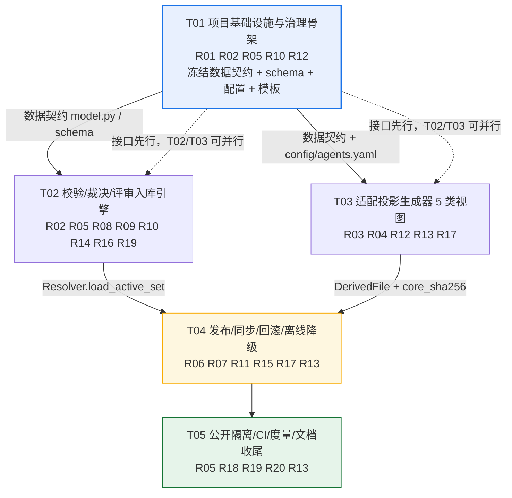

# 02 · 架构设计：个人 Agent 规则中枢（agent_rules_hub）

> 阶段：**策划方案 / 系统架构设计 + 任务分解**。本文**不含可运行代码**，只定义技术方案、数据契约、映射规则、流程、安全边界与实施顺序；代码实现留待用户确认后由工程师实现。
> 撰写：架构师 高见远（Gao）｜全文简体中文
> 上游强约束：`docs/01-PRD.md`（产品经理 许清楚）。**凡本文与 PRD 冲突之处，以 PRD 为准**，冲突点在第 8 章「待明确事项」中列出。

---

## 0. 设计基线与约束回执

| 项 | 内容 |
| --- | --- |
| 上游输入 | `01-PRD.md` 全文（三类资产、四层 + 知识区、7 项约束 C1~C7、20 条需求 R01~R20、目录树、元数据字段、裁决链 6.2、Q1~Q5 建议默认值） |
| 运行环境 | 中文用户；**Windows 为主**（工作区路径 `C:/Users/Hello World/WorkBuddy/My Memory` 含空格）；需考虑跨设备、Git Bash 与 PowerShell 并存、CRLF |
| 本阶段交付物 | `docs/02-架构设计.md`（本文）、`docs/class-diagram.mermaid`、`docs/sequence-diagram.mermaid` |
| 明确不做 | 不创建/修改任何仓库实现文件；不写可运行脚本；不启动任何 Agent 接入的实测（实测属于后续实施任务 T03） |
| 技术结论标注约定 | `[S#]` = 引用 PRD 1.2 已核实来源；`[A#]` = 本阶段新增联网核实来源（见附录）；`【经验判断】` = 未获官方逐条核实、需本机实测或按常识推断 |
| 与默认技术栈的偏离 | PRD 0 明确「本阶段不涉及默认前端技术栈」，故**不采用** Vite / React / MUI / Tailwind。本方案落地形态是「纯文本内容资产库 + Python 工具链」，属有意偏离，已记录 |

### 0.1 本次新增核实来源（真实，未虚构）

| 编号 | 结论 | 来源 |
| --- | --- | --- |
| **[A1]** | Windows 上 POSIX symlink 无精确等价；默认仅管理员可建，或需开启 **Developer Mode**；**Git for Windows 默认 `core.symlinks=false`**，克隆时会把符号链接**降级成含目标路径的纯文本文件**；Git Bash 的 `ln -s` 默认创建**副本**而非链接；**目录 junction（`mklink /J`）普通用户可建、无需 UAC，但仅支持本地绝对目录路径**；含空格路径受支持 | Git for Windows 官方 Wiki《Symbolic Links》：https://github.com/git-for-windows/git/wiki/Symbolic-Links ；交叉印证 Stack Overflow https://stackoverflow.com/questions/5917249/git-symbolic-links-in-windows/16754068 |
| **[A2]** | **GitHub 可见性是「仓库级」，不是「分支级」**：官方社区 Verified answer 明确 "a repository is either public or private, you can't make only one branch public and the others private"；官方中文文档亦说明可见性变更作用于整个仓库及其分支/fork 网络 | GitHub Community 官方讨论（Verified answer）https://github.com/orgs/community/discussions/131435 ；GitHub Docs 中文《设置存储库可见性》https://docs.github.com/zh/enterprise-cloud@latest/repositories/managing-your-repositorys-settings-and-features/managing-repository-settings/setting-repository-visibility |

> 这两条直接决定了第 2 章（**排除软链作主方案**）与第 7 章（**必须双仓库，不能"私有仓库开一个公开分支"**）的选型，是本设计最关键的外部事实约束。

---

# Part A · 系统设计

## 1. 实现方案与工具选型

### 1.1 总体范式：**Compiler / Pipeline 模式**

> **一句话**：`GitHub 私有仓库（唯一事实源）` → `确定性生成器（编译）` → `5 类只读派生产物（目标文件）` → `幂等同步器（部署到各 Agent 目录）` → `本地快照（离线降级）`；每一次变更走 `一次评审 + 一次版本化发布 + 一次全端投影`，Git 提供版本 / 回滚 / 审计。

采用 **Compiler（编译）隐喻** 是整套设计的核心，它让 PRD 5.5 的「派生产物只读」变成**自然结论**而非靠人自觉：

| 编译世界 | 本方案 | 对应 PRD |
| --- | --- | --- |
| 源码（唯一可编辑） | `00/`~`40/`、`drafts/` 的 Markdown + YAML frontmatter | R01、C1 |
| 编译器 | `hub/` Python 工具链（validate → resolve → project → hash → publish） | R02、R04、R10 |
| 目标码（不可手改） | `90-adapters/**` 的 AGENTS.md / CLAUDE.md / *.mdc / *.instructions.md / MEMORY.md / skills/ | R03、R04 |
| 构建清单 + 符号表 | `manifest.yaml`（条目索引 + 版本锚点 + ID 注册表） | R02、R06 |
| Build ID | `YYYY.MM.DD-N` 发布版本 + `rules/<version>` tag | R06 |
| 构建产物校验和 | `audit/releases/<ver>/snapshot.json`（全文件 SHA-256 + 哈希链） | R06、R07 |
| 部署 | `hub sync` 幂等落盘（原子替换 + 漂移检测） | R15、R17 |
| 回滚 | `hub rollback <version>` 读快照 → 重投影 → 全端同步 | R07 |
| 断网兜底 | `.state/last-good/` 本地快照 + 显式版本标注 | R11 |

配套模式：**Registry**（`manifest.yaml` 作条目注册表 / 版本锚点 / ID 分配器）、**Strategy**（每个 Agent 一个 `Adapter` 策略，新增 Agent 只加一个策略文件 → R12/C7）、**Fail-closed Gate**（校验/敏感/裁决任一失败即非零退出，不产生半份发布物）。

### 1.2 核心难点与对策

| # | 难点 | 对策 | 依据 |
| --- | --- | --- | --- |
| D1 | 「同一份内容，五种互不相认的格式」 | 定义**唯一 `core_block` 字节串**（L0+L1+裁决链+版本头），由同一内存对象渲染给所有常驻视图；`core_sha256` 跨视图相等性断言 | [S2] avoid contradictory copies；R04 |
| D2 | 「就近具体优先」必须**机器可判定**，不能靠 Agent 猜 | `scope` / `applies_when` 全部结构化（对象 + 枚举 + glob），`Resolver.specificity()` 数值化打分，`expires` ISO 8601 UTC 机器比较 | PRD 3.3、6.2；R10 |
| D3 | 常驻上下文有限 vs 内容会越攒越多 | 宪法/偏好**短且常驻**并设 `length_budget`；技能走渐进式披露只暴露 name+description；经验区**完全不投影到常驻视图** | [S4] 渐进式披露、[S7] <200 行；R16 |
| D4 | 手工改派生产物导致漂移 | 统一只读 header + `core_sha256` + `status` 漂移检测 + 下次 publish 覆盖并告警 + CI 二次校验 | R04、R17 |
| D5 | 私有内容误入公开物 | `sensitivity` 机器判定 + **5 层 fail-closed 闸门** + 双仓库物理隔离 | R05、C4 |
| D6 | Windows 平台差异 | **不使用 symlink** 作分发手段；Python `pathlib` 全路径处理；`.gitattributes` 强制 LF；UTF-8 无 BOM | [A1] |
| D7 | 多设备并发改同一批规则 | 中央 `id_registry` 分配 ID、`sync --plan` 先 diff 后逐条确认、冲突不自动合并而是回 `drafts/` 走评审 | R09、R15 |
| D8 | 断网时静默用旧规则 | `.state/sync-state.json` 记录版本 + 同步时间；降级时向所有投影头部/会话提示**显式标注**；恢复后强制差异确认 | R11、C5 |

### 1.3 技术选型表（含备选对比与不选理由）

| 层 | 选定 | 理由 | 备选 | **不选的原因** |
| --- | --- | --- | --- | --- |
| 内容格式 | **Markdown + YAML frontmatter** | 与 Agent Skills(`SKILL.md`)、Cursor `.mdc`、Copilot `*.instructions.md` 的既有约定天然同构 [S4][S8][S11]；纯文本可 Git diff、可人工审阅、离线可读 | JSON / 数据库 / Notion | 人不可读、diff 差、离线不可用、违背 C5 与「低摩擦沉淀」 |
| 脚本语言 | **Python 3.11+** | 标准库 `pathlib/hashlib/json/datetime/argparse` 足够；Windows/macOS/Linux 行为一致；UTF-8 中文稳；不写任何平台相关 shell 逻辑（规避 Git Bash vs PowerShell 差异与路径空格问题） | Bash / PowerShell、Node.js | Bash 在 Windows 路径空格、CRLF、编码上易碎；PowerShell 跨设备不便；Node 亦可但 YAML/Schema/模板生态与文本处理不如 Python 顺手【经验判断】。**结论：工具链只用 Python，用户不写 shell** |
| YAML 解析 | **PyYAML ^6.0** | 成熟、跨平台；frontmatter 结构可控 | `ruamel.yaml` | 需保留注释/顺序时才升级，MVP 不需要【经验判断】 |
| Schema 校验 | **jsonschema ^4.20** | 把 PRD 5.4 的「必填字段」「枚举」「L3 必填 expires」「L0 必填 override」变成机器规则，缺字段**不予发布并返回原因**（R02） | 手写 if 判断 | 规则会演化，硬编码易漏；声明式 schema 可被 CI 与本地共用 |
| 模板 | **Jinja2 ^3.1** | 每个 Agent 一个可读模板，`config/agents.yaml` 驱动，新增 Agent 不改正排逻辑（R12） | 字符串拼接 | 拼接必然导致各视图正文悄悄分叉，直接违背 R04 |
| CLI | **argparse（标准库）**，可选 click | 子命令 `validate / plan / publish / sync / rollback / status / promote / onboard`；零额外依赖降低接入成本（C7） | click / typer | 锦上添花，非必需；MVP 用标准库 |
| 校验值 | **SHA-256**（对统一 LF + UTF-8 无 BOM 字节） | 标准库 `hashlib`、跨语言可复核、足以做漂移/查重/哈希链 | BLAKE3 / MD5 | BLAKE3 性能优势在几十个小文件上无意义且增依赖；MD5 不安全【经验判断】 |
| 版本化 | **Git + annotated tag `rules/<ver>` + 快照 JSON** | Git 天然满足单一事实源 / diff / 回滚 / 审计 / 离线 [S18][S19][S20]；tag 提供不可变锚点 | 自建版本号数据库 | 重复造轮子，且离线不可用 |
| 分发落盘 | **纯文件复制（`copy` + 临时目录 + 原子替换）** | 避开 Windows symlink 权限陷阱 [A1]；行为确定、可校验、可回滚 | symlink / junction / GNU Stow | 见第 2 章方案③：**硬排除作主方案** [A1] |
| CI | **GitHub Actions** | push/PR 触发校验，main 触发公开发布；与 GitHub 事实源同址 | 本地 cron / 自建 runner | MVP 无必要；CI 的关键是提供**独立于本机的第二道敏感扫描**（第 7 章） |
| 加密（可选） | **不加密，靠 `.gitignore` + 双仓库隔离** | 用户诉求是「规则文本」而非密钥；加密会破坏纯文本可读性与 Git diff | `git-crypt` / `age` | 仅当后续确需把密钥类文件放进仓库时才引入，列为 P2 可选项 |
| 记忆 / 连接层 | **明确为旁路，不纳入主干** | MCP 管连接不管内容版本/审定/离线 [S12][S14]；mem0 是动态记忆、无人工评审与显式版本 [S15][S16] | 用 mem0 / MCP Server 作规则存储 | 违背 R19 与 C1；且 MCP 需常驻服务、断网不可用（违背 C5 与 C7） |

### 1.4 Windows / 中文 / 跨设备专项（硬约束）

| 问题 | 事实 | 设计动作 |
| --- | --- | --- |
| 符号链接权限 | [A1]：Windows symlink 默认需管理员或 Developer Mode；Git for Windows 默认 `core.symlinks=false`，克隆时把链接**变成纯文本**；Git Bash `ln -s` 默认建副本 | **主方案完全不用软链**，改为「生成 + 复制 + 校验值绑定」；软链仅作为第 2 章被评估后排除的方案 |
| 路径含空格 | 用户工作区 `C:/Users/Hello World/...`；[A1] 确认含空格路径可被支持，但必须正确引用 | 全部走 `pathlib.Path`；`HUB_ROOT` 由环境变量或 `config/hub.yaml` 解析；**禁止字符串拼接 shell 命令**；文档中所有示例路径加引号 |
| CRLF | Windows 默认 CRLF，会让同一份文件在不同设备上 SHA-256 不同，破坏 R04/R06 校验 | 仓库根 `.gitattributes`：`* text=auto eol=lf`，并对 `*.md /*.yaml /*.yml /*.json` 显式 `eol=lf`；生成器一律以 `\n` 写出、UTF-8 **无 BOM**；`.editorconfig` 同步约束 |
| Git Bash vs PowerShell | 两套 shell 对引号、路径、退出码处理不同 | 用户只接触**一层统一的 Python CLI**（`python -m hub ...`），不提供平台相关 `.sh`/`.ps1` 主逻辑；如需便捷入口，仅生成一层极薄包装 |
| 中文文件名 | PRD 5.3 要求小写 kebab-case、禁空格中文大写 | 生成器在 `validate` 阶段对文件名做 ASCII kebab-case 正则校验，违者阻断；**正文内容**保持简体中文 UTF-8 |
| 跨设备 | 每台设备 Agent 安装路径不同 | `config/hub.yaml` 用**路径模板 + 变量**（如 `${HOME}/.workbuddy/`、`${WORKSPACE}/.cursor/rules/`），每台设备一份 `config/hub.local.yaml`（不入库）覆盖；生成器按设备解析目标路径 |
| 时间 | 跨时区 / 本机时钟 | 所有时间字段 **ISO 8601 UTC**（`2026-11-09T08:30:00Z`），比较一律用 UTC，不依赖本地时区 |

---

## 2. 同步 / 分发机制专题对比（重点）

### 2.1 五种候选方案定义

| 编号 | 方案 | 描述 |
| --- | --- | --- |
| **①** | **本地 clone + 生成器投影 + 幂等复制落盘** | 每台设备 clone 私有主干；`hub publish` 在本机生成全部派生产物与快照；`hub sync` 把它们**复制**到各 Agent 约定目录（`AGENTS.md` 到项目根、`~/.workbuddy/MEMORY.md` 等），落盘前后比对 SHA-256 |
| **②** | **Git submodule / sparse checkout** | 把主干（或只把 `90-adapters/` 发布分支）作为 submodule 挂进每个项目，或 `sparse-checkout` 只取派生产物目录，`git pull` 即同步 |
| **③** | **symlink / junction / GNU Stow 式软链** | 各 Agent 目录里放指向仓库文件的链接，改主干即"自动"生效，零复制 |
| **④** | **GitHub raw URL / MCP Server 远程按需拉取** | Agent 运行时按 URL 或 MCP `resources` 拉取最新规则，不落盘或只缓存 |
| **⑤** | **CI 自动生成并发布到发布分支 / tag** | push 触发 GitHub Actions，服务端生成全部投影 + 快照 + CHANGELOG，推送到 public 仓库 / tag；客户端只 `git pull` |

### 2.2 六维对比表

> 评级：◎ 优 / ○ 中 / △ 弱 / ✕ 不满足。

| 维度 | ① clone+生成+复制 | ② submodule / sparse | ③ symlink / junction / Stow | ④ raw URL / MCP | ⑤ CI 发布分支/tag |
| --- | --- | --- | --- | --- | --- |
| **一致性保证（R04/C1）** | ◎ 复制前后 SHA-256 强校验 + 漂移检测 + 原子替换；全端同一 `core_sha256` | ○ 内容一致但**目标文件名/位置**仍需额外映射，`AGENTS.md` 等约定名无法靠 submodule 直接落位 | ○ 物理上只有一份，但链接失效时静默变"纯文本文件" [A1] | △ 依赖拉取时机，可能 A 端旧 B 端新；无落盘校验 | ◎ 服务端单点生成，产物不可变、可校验 |
| **离线可用（R11/C5）** | ◎ 本地有完整主干 + `.state/last-good/` 快照，断网可工作且可显式标注版本 | ○ 需已 checkout；快照/版本标注需另做 | ○ 链接目标在本地即可用，但无"版本 + 同步时间"元数据 | ✕ **断网即失效**（raw 拉取失败 / MCP server 不可达） | ○ 需已 pull；发布物本地有则可离线用 |
| **私有隔离（R05/C4）** | ◎ 私有主干只在本地/私有仓库；公开物由 `--scope public` 单独生成 | △ submodule 会把整个仓库暴露给项目；私有内容易被误提交 | ✕ 链接把私有仓库路径结构暴露给每个项目 | △ 需鉴权，token 分发与轮换是负担 | ◎ 只把 `sensitivity: public` 的生成物推 public 仓库，物理隔离最干净 |
| **维护成本（C2/C7）** | ○ 需装 Python + 3 个轻依赖；但一次配置后 `hub sync` 一条命令 | △ 每个项目都要维护 submodule 指针，易出现"指针指向旧 commit" | △ Stow/链接布局维护成本高，Windows 上尤其 [A1] | △ 需常驻服务/URL 管理/鉴权，且每个 Agent 都要支持 | ◎ 服务端一次配置，客户端只 pull |
| **Windows 兼容性** | ◎ 纯文件复制，`pathlib` 处理空格路径，无权限要求 | ○ Git 层可用，但落位仍需复制 | ✕ **[A1]：symlink 需管理员/开发者模式，Git 默认 `core.symlinks=false` 会把链接降级成纯文本；junction 不需 UAC 但**仅目录、仅本地绝对路径**，且 Git 不友好 → 无法覆盖 `MEMORY.md` 这类单文件** | ○ 网络层跨平台，但依赖 Agent 运行时支持 | ◎ 服务端 Linux runner，客户端只 pull |
| **冲突风险（多份矛盾副本）** | ◎ 单一出口生成；手工改动被检出、告警、下次覆盖 | △ submodule 指针滞后 = 事实上的旧副本 | △ 链接被误删/被 Git 降级为文本 = 隐性副本 | △ 缓存与远端版本错配，且无版本标注 | ◎ 产物不可变 |
| **满足的需求** | R03 R04 R11 R15 R17 | R15（弱） R18 | （均不满足核心） | R18（弱） | R05 R06 R08 R18 |

### 2.3 推荐结论

> **主方案 = ① + ⑤ 组合（本地确定性生成 + 服务端不可变发布）**
> **兜底方案 = ② sparse checkout 只取发布分支（轻量只读设备）**
> **降级方案 = ① 内置的 `.state/last-good/` 本地快照（断网，非第六种分发机制）**
> **明确排除 = ③ 作主方案、④ 作主方案**

**推荐理由（逐条）**

1. **① 是唯一同时满足 C1/C2 与 Windows 现实的选择**：它把「格式适配」收敛到唯一生成器出口，落盘是纯复制，天然绕开 [A1] 的软链陷阱；`core_sha256` + 快照让"多份矛盾副本"从**纪律问题**变成**可自动检出的机器问题**。
2. **⑤ 补上"云端已发布真相"与公开分享（R18）**：服务端生成一次、产物不可变、可被他人 `git clone`；同时提供**独立于本机的第二道敏感扫描**（第 7.2 节），防止本机误配绕过 R05。
3. **④ 被排除的根本原因不是技术，是产品**：MCP/远程拉取需要常驻服务与网络，直接违背 **C5 离线降级**与 **C7 低接入成本**；且 MCP 明确定位为连接协议，不解决"谁审定 / 如何版本化 / 如何裁决" [S12][S14]（PRD 1.3 启示 6 已定调）。可作 P2 的**可选旁路**（只读暴露公共技能清单），永不作为事实源。
4. **③ 被排除是 [A1] 的硬事实**：非管理员不可建 symlink、Git for Windows 默认把链接当纯文本、`junction` 只支持目录 → 无法覆盖 `AGENTS.md` / `CLAUDE.md` / `MEMORY.md` 这类**单文件约定名**，而这正是 R03/R12 的验收对象。故软链最多作为"高级用户在已开启 Developer Mode 时的可选优化"，不入主方案。
5. **② 作兜底**而非主方案：它无法把文件放到 `~/.workbuddy/`、`~/.claude/` 这类**用户级目录**（submodule 只能落在项目内），也不产生 `core_sha256` / 版本标注，无法独立满足 R04、R11、R17。但它在"一台只想消费、不想装 Python 的临时设备"上成本最低：只需 `git clone --filter=blob:none --sparse` 取 `90-adapters/` 发布分支即可。
6. **组合后的数据流向**：主干编辑（仅本机/私有仓库）→ ① 本机 `publish` 出投影 + 快照 → ⑤ CI 校验并生成 public 子集 → 各设备 `sync --plan` 看差异 → 确认后 `sync apply` 落盘 → 断网则读 `last-good`。**任何时刻只有一份可编辑正文**（C1）。

### 2.4 如何满足 R11 / R15 / R17（逐条落地）

| 需求 | 机制 | 具体产物 |
| --- | --- | --- |
| **R11 离线降级** | `hub sync` 每次成功落盘后，把当次快照 + 全部派生产物复制到 `.state/last-good/`，并写 `.state/sync-state.json`：`{version, synced_at_utc, snapshot_sha256, offline:false}`。启动探测主干失败 → 读 `last-good` → 在每份投影头部追加 `OFFLINE-SNAPSHOT` 标记并向用户输出「当前使用版本 X，最后同步于 Y，可能已过期」 | `.state/last-good/**`、`.state/sync-state.json`、头部标记；恢复网络后**强制走 R15 差异确认**，禁止静默套用 |
| **R15 增量同步与差异确认** | `hub sync --plan` 先计算「本地已落盘版本 → 主干目标版本」的**按规则 ID 粒度** diff（新增 / 修订 / 废弃 / 过期），生成 `.state/pending.diff`；用户逐条 accept / reject 后才 `hub sync apply`；完成后输出 `本地版本 → 主干版本` 变化报告 + `affected_agents` 清单 | `.state/pending.diff`、diff 报告、`audit/ledger.jsonl` 的 sync 事件 |
| **R17 接入状态自检** | `hub status` 读取 `config/agents.yaml` 的 Agent 注册表，逐项：① 目标文件是否存在 ② 落盘文件 `sha256` 是否等于当前快照中的值 ③ 版本是否与 `manifest.yaml` 一致 ④ 上次同步时间；不一致项**显式标红**并给出修复命令 | 终端/JSON 状态表：`agent / target / version / consistent / last_sync / drift` |

---

## 3. 完整文件列表

> 属性列：**E**=可编辑主干 / **R**=只读派生产物 / **G**=由工具生成 / **L**=仅本地不入库；**Git**=是否入库；**Public**=是否进入公开发布物。
> PRD 5.1 目录树**全部节点**均在下表覆盖；其后为架构师新增的必要文件。

### 3.1 主干与治理（PRD 目录树全覆盖）

| 路径 | 职责 | 属性 | Git | Public |
| --- | --- | --- | --- | --- |
| `README.md` | 人类入口：是什么 / 分层速查 / 接入 / 贡献 | E | ✓ | ✓（公开版重新生成） |
| `GOVERNANCE.md` | 治理宪法：分层定义、**6.2 裁决链**、评审与发布流程、变更权限 | E | ✓ | ✓（仅治理通用部分） |
| `CHANGELOG.md` | 人类可读变更记录，**由 publish 从 ADR 自动生成，禁止手写** | G | ✓ | ✓ |
| `manifest.yaml` | 全局清单：仓库版本、发布时间、分层优先级表、**条目 ID 索引与注册表**、上一快照哈希 | E/G | ✓ | ✓（公开版为子集） |
| `00-constitution/CORE.md` | L0 硬约束总纲：语言、结构化、不编造事实与链接 | E | ✓ | ✓ |
| `00-constitution/SAFETY.md` | L0 安全红线：敏感隔离、破坏性操作二次确认 | E | ✓ | ✓ |
| `10-preferences/communication.md` | L1 输出语言 / 结构化 / 语气 / 禁用套话 | E | ✓ | ✓ |
| `10-preferences/formatting.md` | L1 表格 / Mermaid / 文档形态 | E | ✓ | ✓ |
| `10-preferences/workflow.md` | L1 先计划后执行 / 验收标准 / 不确定先问 | E | ✓ | ✓ |
| `20-experience/EXP-0001-*.md` … | 经验条目：一条一文件（场景+结论+依据+失效条件） | E | ✓ | ✕（默认私有） |
| `20-experience/_index.md` | 经验索引（按元数据聚合、状态标注），**生成器产出** | G | ✓ | ✕ |
| `30-skills/<name>/SKILL.md` | L2 技能主文件：name + description + 步骤 + 验收 | E | ✓ | 仅 `sensitivity: public` 者 |
| `30-skills/<name>/references/` | 技能附属模板 / 示例 / 检查清单（按需加载） | E | ✓ | 同上 |
| `30-skills/<name>/CHANGELOG.md` | 技能自身变更历史 | G | ✓ | 同上 |
| `40-projects/<proj>/OVERRIDES.md` | L3 例外，**必填 `expires`**，仅该项目生效 | E | ✓ | ✕ |
| `40-projects/<proj>/README.md` | 为何例外 / 何时清理 / 谁确认 | E | ✓ | ✕ |
| `drafts/<候选>.md` | 候选区，四步评审前不参与任何发布 | E | ✓ | ✕ |
| `90-adapters/**` | 全部投影视图（见 3.4） | **R** | ✓（私有仓）/ ✓（public 子集） | 仅 public 子集 |
| `99-private/README.md` | 私有覆盖层使用说明（本地合并顺序） | L | ✕ | ✕ |
| `99-private/overrides.yaml` | 本机私有覆盖规则（**不入库、不公开**） | L | ✕ | ✕ |
| `audit/decisions/ADR-<nnnn>-*.md` | 决策记录：为何新增/修订/废弃/晋升 | G | ✓ | ✕（含私有来源） |
| `audit/releases/<ver>/snapshot.json` | 发布快照：版本 + 全文件 SHA-256 + 变更 ID + 影响 Agent + 哈希链 | G | ✓ | ✓（公开快照子集） |

### 3.2 工具链（架构师新增，`hub/` Python 包）

| 路径 | 职责 | 属性 | Git | Public |
| --- | --- | --- | --- | --- |
| `pyproject.toml` / `requirements.txt` | 依赖声明与 CLI 入口注册（`python -m hub`） | E | ✓ | ✓ |
| `hub/__init__.py` | 包版本常量 | E | ✓ | ✓ |
| `hub/cli.py` | CLI 子命令分发：`validate / plan / publish / sync / rollback / status / promote / onboard` | E | ✓ | ✓ |
| `hub/config.py` | 路径解析（`HUB_ROOT`、`hub.local.yaml` 设备覆盖）、长度预算、开关 | E | ✓ | ✓ |
| `hub/model.py` | **数据契约先行**：`Asset / Scope / AppliesWhen / Manifest / Release / LoadSet / DerivedFile` 数据类与枚举（T01 冻结接口，T02/T03 按契约实现） | E | ✓ | ✓ |
| `hub/hashing.py` | `file_sha256` / `content_hash`（规范化正文）/ `core_sha256` / `prev_snapshot_sha256` | E | ✓ | ✓ |
| `hub/frontmatter.py` | YAML frontmatter 读写与规范化（LF、UTF-8、NFC） | E | ✓ | ✓ |
| `hub/validator.py` | schema 校验、必填字段、状态机合法性、ID 唯一、查重合并、文件名 kebab-case | E | ✓ | ✓ |
| `hub/sensitive.py` | 敏感模式扫描与 **fail-closed 阻断**（R05） | E | ✓ | ✓ |
| `hub/resolver.py` | 加载集合计算：`status: active` 过滤、过期过滤、`specificity()`、**6.2 裁决链**、无法裁决 → `needs_review` + 提问 | E | ✓ | ✓ |
| `hub/projection.py` | 投影编排：构造唯一 `core_block` → 遍历 `config/agents.yaml` → 调用各 Adapter → 断言跨视图哈希相等 | E | ✓ | ✓ |
| `hub/adapters/base.py` | `Adapter` 抽象接口 + 统一只读 header 模板 | E | ✓ | ✓ |
| `hub/adapters/agents_md.py` | → `90-adapters/AGENTS.md` | E | ✓ | ✓ |
| `hub/adapters/claude.py` | → `CLAUDE.md` + `claude/rules/*.md` | E | ✓ | ✓ |
| `hub/adapters/cursor.py` | → `cursor/rules/*.mdc`（globs / alwaysApply 生成） | E | ✓ | ✓ |
| `hub/adapters/copilot.py` | → `copilot/copilot-instructions.md` + `*.instructions.md`（applyTo 生成） | E | ✓ | ✓ |
| `hub/adapters/workbuddy.py` | → `workbuddy/MEMORY.md` + `workbuddy/skills/**` | E | ✓ | ✓ |
| `hub/publish.py` | 版本号生成、快照、CHANGELOG、ADR 骨架、tag、public 子集导出 | E | ✓ | ✓ |
| `hub/sync.py` | 幂等落盘（临时目录 + 原子替换）、`--plan` diff、逐条确认、漂移检测、离线降级 | E | ✓ | ✓ |
| `hub/rollback.py` | 按版本快照回退 + 重投影 + 记回滚 ADR | E | ✓ | ✓ |
| `hub/audit.py` | ADR / `audit/ledger.jsonl` / 哈希链 / 命中反馈记录（R13、R20） | E | ✓ | ✓ |
| `hub/metrics.py` | P2：规则命中 / 被覆盖 / 被纠正次数报表（R20） | E | ✓ | ✓ |

### 3.3 Schema / 模板 / 配置 / CI（架构师新增）

| 路径 | 职责 | 属性 | Git | Public |
| --- | --- | --- | --- | --- |
| `schema/frontmatter.schema.json` | 规则文件 frontmatter 的机器契约（PRD 5.4 全部字段 + 条件必填） | E | ✓ | ✓ |
| `schema/manifest.schema.json` | `manifest.yaml` 契约 | E | ✓ | ✓ |
| `schema/skill.schema.json` | `SKILL.md` frontmatter 契约（name/description 长度约束 [S6]） | E | ✓ | ✓ |
| `schema/release.schema.json` | 快照契约（含哈希链字段） | E | ✓ | ✓ |
| `templates/experience.md.tpl` | 经验模板：场景 + 结论 + 依据 + 失效条件（R16） | E | ✓ | ✓ |
| `templates/preference.md.tpl` | 偏好模板：单条祈使句 + 适用范围（R16） | E | ✓ | ✓ |
| `templates/skill/SKILL.md.tpl` | 技能模板：触发条件 + 步骤 + 验收（R16、[S4]） | E | ✓ | ✓ |
| `templates/project-overrides.md.tpl` | L3 例外模板（强制 `expires` + 理由） | E | ✓ | ✓ |
| `templates/adr.md.tpl` | ADR 模板（R08） | E | ✓ | ✓ |
| `templates/adapters/*.tpl` | 各 Agent 投影模板（**统一 header + 唯一 core_block 占位**） | E | ✓ | ✓ |
| `config/hub.yaml` | 全局配置：设备清单、目标路径模板、长度预算、Agent 开关、发布范围、版本策略 | E | ✓ | ✓ |
| `config/hub.local.yaml` | **每台设备私有**路径覆盖（不入库） | L | ✕ | ✕ |
| `config/agents.yaml` | **Agent 注册表**：id / 目标文件名 / 目标路径 / 常驻或按需 / frontmatter 映射 / 验证方法 → 自动生成 R12 一页清单 | E | ✓ | ✓ |
| `config/priority.yaml` | **裁决优先级唯一真源**（6.2 的 0~4 序 + tie-break 规则） | E | ✓ | ✓ |
| `config/sensitive-patterns.yaml` | 敏感模式清单 + 私有词表引用（R05） | E | ✓ | ✓ |
| `config/private-terms.txt` | 用户自定义「绝不公开」词表（项目代号 / 客户名 / 内部术语） | L | ✕ | ✕ |
| `.gitattributes` | `* text=auto eol=lf`；`90-adapters/** linguist-generated=true` | E | ✓ | ✓ |
| `.gitignore` | `99-private/`、`config/hub.local.yaml`、`config/private-terms.txt`、`.state/`、`__pycache__/`、`.env` | E | ✓ | ✓ |
| `.editorconfig` | UTF-8 / LF / 无 BOM / 尾随空格 | E | ✓ | ✓ |
| `.github/workflows/validate.yml` | PR/push：schema + 查重 + 敏感 + 幂等复现 + 跨视图哈希相等断言 | E | ✓ | ✓ |
| `.github/workflows/publish.yml` | main：生成 public 子集 → **独立二次敏感扫描** → 推 `agent-rules-hub-public` + 打签名 tag | E | ✓ | ✓ |
| `ONBOARDING.md` | **一页接入清单（R12）**：由 `config/agents.yaml` 自动生成，含"认哪些文件 / 放哪 / 如何验证" | G | ✓ | ✓ |
| `SELF-CHECK.md` | 接入状态自检清单（R17）：`hub status` 用法与判读 | G | ✓ | ✓ |
| `BOUNDARY.md` | **R19 边界文档**：动态记忆不得自动写入主干；欲成规则必须走 R09 | E | ✓ | ✓ |
| `CONTRIBUTING.md` | 公开分享贡献指南（R18） | E | ✓ | ✓ |
| `SKILLS-INDEX.md` | 公开技能清单（R18），由生成器从 `sensitivity: public` 聚合 | G | ✓ | ✓ |
| `LICENSE` | 公开仓库许可证（用户待定，见第 8 章） | E | ✓ | ✓ |

### 3.4 派生产物（`90-adapters/**`，**全部只读 R**）

| 路径 | 目标 Agent | 属性 | Git | Public |
| --- | --- | --- | --- | --- |
| `90-adapters/AGENTS.md` | 跨 Agent 通用视图 | R | ✓ | 公开子集 |
| `90-adapters/CLAUDE.md` | Claude Code 入口（**指针模式**优先，见 5.4） | R | ✓ | 公开子集 |
| `90-adapters/claude/rules/*.md` | Claude Code 分主题规则 | R | ✓ | 公开子集 |
| `90-adapters/cursor/rules/*.mdc` | Cursor 规则（含 `description/globs/alwaysApply`） | R | ✓ | 公开子集 |
| `90-adapters/copilot/copilot-instructions.md` | Copilot 全仓常驻入口 | R | ✓ | 公开子集 |
| `90-adapters/copilot/instructions/*.instructions.md` | Copilot 按 `applyTo` 匹配 | R | ✓ | 公开子集 |
| `90-adapters/workbuddy/MEMORY.md` | WorkBuddy 用户级记忆视图 | R | ✓ | 公开子集 |
| `90-adapters/workbuddy/skills/<name>/SKILL.md` | WorkBuddy 技能视图（**与 `30-skills` 同一份字节**） | R | ✓ | 公开子集 |
| `90-adapters/.generated-manifest.json` | 派生产物校验值索引：每文件 `sha256` + `core_sha256` + 来源版本 + 生成时间锚（R04 漂移检测） | R | ✓ | 公开子集 |

> **文件名严格等于目标 Agent 约定名**（PRD 5.3 第 6 条），不可自定义 —— 这是 R12「≤3 步接入」的前提。

### 3.5 本地状态与私有层（不入库）

| 路径 | 职责 | 属性 |
| --- | --- | --- |
| `.state/sync-state.json` | 当前版本 / 最后同步 UTC 时间 / 快照哈希 / 是否离线 | L |
| `.state/last-good/**` | 最近一次成功同步的完整派生产物快照（**R11 离线降级数据源**） | L |
| `.state/pending.diff` | `sync --plan` 产出的待确认差异（R15） | L |
| `99-private/overrides.yaml` | 本机私有覆盖规则，合并顺序见 7.3 | L |

---

## 4. 数据模型与格式规范

### 4.1 类图（数据结构与接口）

> 独立文件：`docs/class-diagram.mermaid`



**关系说明**：`Asset` 组合 `Scope` 与 `AppliesWhen`（机器可判定的作用域/触发条件）；`Asset` 自关联表达 `supersedes/superseded_by`（经验晋升不复制正文，PRD 3.1）；`Manifest` 聚合全部 `Asset` 并持有 `id_registry`；`Resolver` 依 `config/priority.yaml` 产出 `LoadSet`（含唯一 `core_block`）；`Projection` 以 Strategy 模式分派给 `1..*` 个 `Adapter`（**新增 Agent = 新增一个 Adapter，0 改动主干，R12/C7**）；`Publisher` → `Release`（快照）；`Syncer` 消费快照并负责漂移/离线；`Rollback` 读历史快照后**必须回调 Publisher 重新投影**（保证全端一致回退，PRD 6.1）。

### 4.2 `manifest.yaml` 示例

```yaml
# 唯一事实源的全局清单；由 hub publish 更新，人工可审阅
schema_version: 1
repo: agent_rules_hub
version: "2026.11.09-1"                  # 当前发布版本（CalVer + 当日序号）
published_at: "2026-11-09T08:30:00Z"    # ISO 8601 UTC
prev_snapshot_sha256: "9f2c...e41b"      # 上一快照哈希 → 形成哈希链

# 裁决优先级唯一真源（与 PRD 6.2 完全一致，另存 config/priority.yaml 供程序读取，此处为人可读镜像）
priority_order:
  - rank: 0
    source: session_explicit_instruction
    note: "用户当前会话显式指令覆盖一切；触及 L0 红线须二次确认并记审计"
  - rank: 1
    source: L0_constitution
    note: "override: forbidden 不可被任何自动规则覆盖"
  - rank: 2
    source: L3_project_temporary
    condition: "status: active 且 now_utc < expires 且 scope 命中当前项目"
  - rank: 3
    source: L1_stable_preference
  - rank: 4
    source: L2_skill_or_experience
    note: "不参与覆盖比较"
tie_break: ["specificity_desc", "updated_at_desc", "priority_asc"]

# 中央 ID 注册表：一经分配不复用、不重排（防多设备撞号）
id_registry:
  CONST: { next: 4, used: ["CONST-0001", "CONST-0002", "CONST-0003"] }
  PREF:  { next: 13, used: ["PREF-0001", "PREF-0012"] }
  EXP:   { next: 3,  used: ["EXP-0001", "EXP-0002"] }
  PROJ:  { next: 2,  used: ["PROJ-apollo-0001"] }
  ADR:   { next: 43, used: ["ADR-0042"] }

asset_index:
  - id: CONST-0001
    path: 00-constitution/CORE.md
    layer: L0
    asset_type: preference
    status: active
    version: 1
    sensitivity: public
    content_hash: "sha256:3a1d...c90f"
  - id: PREF-0012
    path: 10-preferences/formatting.md
    layer: L1
    asset_type: preference
    status: active
    version: 2
    sensitivity: public
    content_hash: "sha256:77be...12d8"
  - id: EXP-0002
    path: 20-experience/EXP-0002-agents-md-nearest-wins.md
    layer: experience
    asset_type: experience
    status: active
    version: 1
    sensitivity: private
    content_hash: "sha256:0c44...ab31"
```

### 4.3 规则文件 YAML frontmatter 示例

**L0 宪法（必填 `override`）**

```markdown
---
id: CONST-0001
layer: L0
asset_type: preference
source: "用户 2026-11-02 纠正：多次出现英文输出与编造来源"
scope: { level: global }
version: 1
created_at: "2026-11-02T10:00:00Z"
updated_at: "2026-11-02T10:00:00Z"
status: active
override: forbidden          # L0 必填
sensitivity: public
owner: gao
approved_by: user
---

## 条款

- 所有输出使用简体中文，结构化（表格 / 分级标题 / Mermaid），不写空话套话。
- 严禁编造事实或来源链接；查不到就明确标注「未经核实 / 经验判断」。
- 不确定时先列澄清问题再动手；破坏性操作先出计划并二次确认。
```

**L1 稳定偏好（含 `applies_when`）**

```markdown
---
id: PREF-0012
layer: L1
asset_type: preference
source: "用户长期习惯，见 ADR-0018"
scope: { level: global, agents: ["*"] }
applies_when: { task_types: ["文档撰写", "方案输出"] }
version: 2
created_at: "2026-10-14T09:00:00Z"
updated_at: "2026-11-08T14:20:00Z"
review_after: "2027-02-08T00:00:00Z"
priority: 20
status: active
sensitivity: public
owner: gao
approved_by: user
supersedes: PREF-0007        # 修订关系，不复制旧正文
---

## 条款

- 文档优先用表格与 Mermaid，避免纯叙述与空话套话。
```

**L3 项目临时（必填 `expires`）**

```markdown
---
id: PROJ-apollo-0001
layer: L3
asset_type: preference
source: "客户 Apollo 交付规范要求（ADR-0039）"
scope: { level: project, projects: ["apollo"], paths: ["projects/apollo/**"] }
expires: "2026-12-31T00:00:00Z"     # L3 必填；到期自动不加载并进复核队列
version: 1
created_at: "2026-11-09T08:00:00Z"
updated_at: "2026-11-09T08:00:00Z"
status: active
sensitivity: private
owner: gao
approved_by: user
---

## 例外（仅本项目、仅有效期内）

- 本项目交付物使用繁体中文（显式确认的 L0 例外，见 ADR-0039 二次确认记录）。
```

**经验条目（知识区，不参与约束裁决）**

```markdown
---
id: EXP-0002
layer: experience
asset_type: experience
source: "[S1] https://agents.md/ （官方，已核实）"
scope: { level: global }
version: 1
created_at: "2026-11-05T11:00:00Z"
updated_at: "2026-11-05T11:00:00Z"
review_after: "2027-05-05T00:00:00Z"
status: active
sensitivity: private
owner: gao
approved_by: user
---

- 场景：多个目录存在 AGENTS.md 时判断哪条生效。
- 结论：离被编辑文件最近的 AGENTS.md 优先；显式用户指令覆盖一切。
- 依据：[S1] 官方规范（已联网核实）。
- 失效条件：目标 Agent 不遵循 AGENTS.md 规范时，需改为该 Agent 专属投影。
```

### 4.4 `SKILL.md` 示例（对齐 Agent Skills 开放标准 [S4][S5]）

```markdown
---
name: ecosystem-research
description: "生成生态/工具对比表：构造关键词组 → 联网检索 → 去重 → 交叉印证 → 附来源链接与核实状态。当需要选型调研、方案对比、技术事实时使用。"
layer: L2
asset_type: skill
scope: { level: global }
applies_when:
  task_types: ["调研", "选型", "对比"]
  triggers: ["对比", "调研", "选型", "有没有更好的"]
  file_globs: ["docs/**/*.md"]
version: 3
created_at: "2026-10-20T09:00:00Z"
updated_at: "2026-11-09T08:00:00Z"
status: active
sensitivity: public
owner: gao
approved_by: user
---

# 生态调研对比表

## 触发条件
需要为技术/工具选型产出可复核的对比表时。

## 步骤
1. 从需求抽取 3~5 组中英关键词组，保留用户原词，不替换近义词。
2. 逐组检索；官方来源优先，第三方资料标注「第三方 / 未核实」。
3. 去重并按维度（承载内容 / 加载时机 / 复用能力 / 局限）归并。
4. 交叉印证：单条结论至少 2 个独立来源，否则标注「经验判断」。
5. 输出表格 + 来源清单 + 核实状态。

## 验收
- 无任何编造链接；每条事实可反查来源。
- 未核实项被显式标注。
- 结论不与 L0/L1 冲突；若冲突，标记 needs_review 并询问用户。
```

> `description` 由 `applies_when` 生成，控制在 1024 字符内 [S6]（第三方参数，作为保守预算）；启动只加载 `name + description`，任务匹配才读全文（渐进式披露 [S4]）。

### 4.5 ADR 示例（`audit/decisions/ADR-0043-*.md`）

```markdown
---
id: ADR-0043
title: "将 EXP-0002 晋升为 L1 偏好条款 PREF-0013"
type: promotion                      # add / revise / deprecate / promote / rollback
created_at: "2026-11-09T08:10:00Z"
proposed_by: gao
approved_by: user
related_ids: ["EXP-0002", "PREF-0013"]
release: "2026.11.09-1"
prev_snapshot_sha256: "9f2c...e41b"
---

## 背景与依据
EXP-0002（AGENTS.md 就近优先）已被 3 次任务反复验证，需从"参考知识"变为"稳定遵守"。

## 决策
新建 PREF-0013；**不复制 EXP-0002 正文**，仅以 `supersedes: EXP-0002` 建立引用链；
EXP-0002 状态置为 `superseded`，`superseded_by: PREF-0013`。

## 评审四步结论
| 步 | 结果 |
| --- | --- |
| 分类 | L1 / preference / global |
| 查重 | 与 PREF-0004 语义重合 → 合并为一条，保留来源引用 |
| 敏感检查 | 通过（无模式命中） |
| 人工确认 | user 于 2026-11-09T08:12:00Z 确认 |

## 影响
affected_agents: [agents_md, claude, cursor, copilot, workbuddy]
changed_ids: ["PREF-0013", "EXP-0002"]
```

### 4.6 发布快照 `audit/releases/2026.11.09-1/snapshot.json` 示例

```json
{
  "schema_version": 1,
  "version": "2026.11.09-1",
  "tag": "rules/2026.11.09-1",
  "created_at": "2026-11-09T08:30:00Z",
  "approved_by": "user",
  "prev_snapshot_sha256": "9f2c...e41b",
  "chain_sha256": "5d81...cc02",
  "manifest_sha256": "ab19...77ef",
  "core_sha256": "e3b0...b855",
  "changed_ids": ["PREF-0013", "EXP-0002"],
  "affected_agents": ["agents_md", "claude", "cursor", "copilot", "workbuddy"],
  "scope": "private",
  "files": [
    {
      "path": "90-adapters/AGENTS.md",
      "sha256": "sha256:1a2b...ff01",
      "size": 7421,
      "source_id": "manifest",
      "source_version": "2026.11.09-1",
      "core_sha256": "e3b0...b855"
    },
    {
      "path": "90-adapters/workbuddy/skills/ecosystem-research/SKILL.md",
      "sha256": "sha256:77be...12d8",
      "size": 1580,
      "source_id": "SKILL-ecosystem-research",
      "source_version": "3"
    }
  ],
  "public_subset": ["AGENTS.md", "CLAUDE.md", "workbuddy/skills/ecosystem-research/**"]
}
```

### 4.7 版本号 / 校验值 / 状态机 / ID 规则

**（1）版本号格式：`YYYY.MM.DD-N`**

| 项 | 规则 |
| --- | --- |
| 格式 | `2026.11.09-1`（四位年 `.` 两位月 `.` 两位日 `-` 当日序号，从 1 起） |
| 唯一性 | 每次 `publish` 生成，同日第 N 次发布序号递增；tag `rules/<version>` 打 annotated tag |
| 可比较 | 比较键为数值元组 `(YYYY, MM, DD, N)`；因各段定长补零，**字典序与数值序等价**，可直接 `sort` |
| 为何不用 SemVer | 规则库没有"破坏性 API 变更"语义；CalVer 天然呼应 R11 的「同步时间」、人一眼看出陈旧程度【经验判断】 |
| 条目自身版本 | 独立整数 `version`（`1,2,3...`），与仓库发布版本解耦，便于单条回溯（PRD 5.4 要求） |

**（2）校验值算法（全部 SHA-256，对统一 LF + UTF-8 无 BOM 字节）**

| 名称 | 计算对象 | 用途 |
| --- | --- | --- |
| `file_sha256` | 派生产物完整文件字节 | R04 漂移检测 / R17 一致性 / R07 回滚校验 |
| `content_hash` | **规范化后的规则正文**：剥离 frontmatter → 去首尾空白 → 统一 `\n` → Unicode NFC → 去行尾空格 | R09 查重合并（相同正文必得相同哈希）/ 检测"同一句话出现在两个可编辑文件" |
| `core_sha256` | 唯一 `core_block`（L0+L1+裁决链+版本头）字节 | **跨常驻视图相等性断言**（R04「差异只在格式」的技术保证） |
| `chain_sha256` | `sha256(prev_snapshot_sha256 + 本快照规范化字节)` | 审计哈希链，防发布记录被静默改写（第 7.5 节） |

**（3）状态机：`draft → active → deprecated → superseded`**

| 迁移 | 触发条件 | 谁可执行 | 生成记录 | 加载行为 |
| --- | --- | --- | --- | --- |
| `draft → active` | 四步评审（分类→查重→敏感→**人工确认**）全通过，`approved_by` 非空 | 用户确认后由 `hub promote` | ADR + manifest 更新 + CHANGELOG | **仅 `active` 参与加载** |
| `draft → rejected` | 评审驳回 / 查重判定为重复且被合并 | 评审流程 | 退回说明 + 保留来源引用 | 不加载 |
| `active → deprecated` | `expires` 到期、`review_after` 超期、或人工废弃（R14） | `hub validate` 自动 / 人工 | ADR + 进入待复核队列 | 立即不加载 |
| `active → superseded` | 被新条目的 `supersedes` 指向（经验晋升 / 查重合并 / 新者胜） | `hub promote` / publish | 新条目 ADR，原条目写 `superseded_by` | 立即不加载，**不删除、不复制正文** |
| `deprecated → active` | 复核通过并续期（必须更新 `updated_at` 与 `version`） | 人工确认 | 新 ADR | 恢复加载 |
| `needs_review`（旁支标记） | 裁决无法判定 / 与约束层冲突 / 长期未命中 | `Resolver` | `audit/ledger.jsonl` 事件 | **不加载**，且向用户提问（PRD 6.2 原则 4） |
| `superseded` / `deprecated` | **终态** | — | — | 永不自动回激活 |

**（4）ID 分配规则**

| 前缀 | 适用 | 文件名格式 | 示例 |
| --- | --- | --- | --- |
| `CONST-` | L0 宪法 | 随所属文件，不单独一文件 | `CONST-0001` |
| `PREF-` | L1 / L3 偏好 | 随所属文件 | `PREF-0012` |
| `EXP-` | 经验 | `EXP-<4位>-<kebab-case-短标题>.md`（PRD 5.3 第 2 条） | `EXP-0002-agents-md-nearest-wins.md` |
| `SKILL-` | 技能 | 目录名即 id 与 `name`，`<kebab-case>/SKILL.md` | `SKILL-ecosystem-research` |
| `PROJ-` | 项目例外 | `40-projects/<kebab-case>/` | `PROJ-apollo-0001` |
| `ADR-` | 决策记录 | `ADR-<4位>-<短标题>.md` | `ADR-0043-promote-exp-0002.md` |

- 全部序号由 `manifest.yaml.id_registry` **集中分配、一经分配不复用不重排**；`hub validate` 校验 ID 唯一性与文件名一致性。
- 跨层引用**只写 ID，不复制正文**（PRD 5.3 第 8 条）；`hub validate` 用 `content_hash` 检出正文重复即阻断发布。

### 4.8 机器可判定的 `scope` / `applies_when` / `expires`

> 设计原则：**全部结构化，禁止自由文本**。任何需要 Agent「读一下再理解」的字段都会退回主观猜测，违背 PRD 6.2 原则 1。

| 字段 | 结构 | 机器判定逻辑 |
| --- | --- | --- |
| `scope.level` | 枚举 `global / project / agent / path` | 基础分值：`global=0, agent=10, project=20, path=30`（可累加） |
| `scope.projects[]` | kebab-case 项目名数组，`["*"]` 表示全部 | 与当前上下文 `ctx.project` 精确匹配；命中则 +20 |
| `scope.agents[]` | Agent id 数组 | 与 `ctx.agent_id` 精确匹配；命中 +10 |
| `scope.paths[]` | glob 数组 | 与 `ctx.file_path` 做 glob 匹配；命中 +30，且匹配路径越长追加分 |
| `specificity_score()` | 上述分值之和 | **数值越大越"就近具体"** → 6.2 原则 1 可判定；同分再用 `updated_at` 新者胜、`priority` 小者胜 |
| `applies_when.task_types[]` | 枚举数组 | 与 `ctx.task_type` 精确匹配 → 决定是否激活技能 |
| `applies_when.triggers[]` | 关键词数组 | 与 `ctx.query` 做包含匹配 → 拼成 Skills `description` / Cursor `description` |
| `applies_when.file_globs[]` | glob 数组 | 直接转 Cursor `globs` 与 Copilot `applyTo`（见 5.5） |
| `applies_when.time_window` | `{from, to}` ISO 8601 UTC | `from <= now_utc < to` 才生效 |
| `expires` | **ISO 8601 UTC 字符串** | `now_utc < expires` 才 `is_loadable()`；否则自动 `deprecated` + 进复核队列（R14 / 6.2 原则 3） |
| `review_after` | 同上 | `now_utc >= review_after` 即标记 `needs_review`，不自动删除 |

`Resolver.load_active_set(Manifest, now_utc)` 的伪逻辑（描述，非实现）：
1. 过滤 `status == active`；
2. 过滤 `expires == null || now_utc < expires`；
3. 过滤 `scope.matches(ctx)` 与 `applies_when` 条件；
4. 按 `config/priority.yaml` 的 rank 分组；
5. 组内冲突按 `specificity_score → updated_at → priority` 定胜者，败者标 `deprecated`（不静默并存）；
6. 跨 rank 冲突按 6.2 裁决（L0 `override: forbidden` 直接胜出并标下层 `needs_review`）；
7. **无法裁决 → 暂停、列出冲突项、向用户提问**（禁止自行取舍 / 编造）；
8. 合并 `99-private/overrides.yaml`（顺序见 7.3）后产出 `LoadSet` 与唯一 `core_block`。

---

## 5. 适配层投影映射表（重点）

### 5.1 主干层 → 目标文件总映射

| 主干层 | `AGENTS.md` | `CLAUDE.md` | `claude/rules/*.md` | `cursor/rules/*.mdc` | `copilot-instructions.md` | `*.instructions.md` | `workbuddy/MEMORY.md` | `workbuddy/skills/**` |
| --- | --- | --- | --- | --- | --- | --- | --- | --- |
| **L0 宪法** | ✅ 常驻（首段） | ✅ 常驻 | ✅ 常驻 | ✅ 常驻 `alwaysApply: true` | ✅ 常驻 | ✅ 常驻 | ✅ 常驻 | ✕ |
| **裁决链（6.2）** | ✅ 常驻（顶部） | ✅ 常驻（顶部） | ✅ 常驻 | ✅ 常驻（顶部） | ✅ 常驻（顶部） | ✅ 常驻 | ✅ 常驻（顶部） | ✕ |
| **L1 稳定偏好** | ✅ 常驻 | ✅ 常驻 | ✅ 分主题 | ✅ 分主题 `.mdc` | ✅ 常驻 | ✅ 按 `applyTo` | ✅ 常驻 | ✕ |
| **L2 技能** | ⚠️ 仅索引行（name+description+路径） | ⚠️ 仅索引行 | ⚠️ 仅索引行 | ⚠️ 仅索引行 | ⚠️ 仅索引行 | ⚠️ 仅索引行 | ⚠️ 仅索引行 | ✅ **完整 SKILL.md 目录**（渐进式披露） |
| **L3 项目临时** | ⚠️ 项目目录级就近投影 + 标注 `expires` | ⚠️ 同上 | ⚠️ 同上 | ⚠️ `.mdc` with `globs` | ⚠️ 同上 | ⚠️ `applyTo` 指向项目路径 | ✕（不进用户级常驻） | ✕ |
| **经验区（知识区）** | ✕ **完全不投影** | ✕ | ✕ | ✕ | ✕ | ✕ | ✕ | ✕ |
| **版本头 / 只读标记** | ✅ 统一 header | ✅ | ✅ | ✅ | ✅ | ✅ | ✅ | ✅（技能文件头） |

> **「经验完全不投影到任何常驻视图」是技术保证，不是纪律要求**：PRD 3.1 明确经验是修订输入、不参与裁决。生成器在 `Resolver` 阶段就把 `layer: experience` 排除出 `LoadSet`，因此**物理上不可能**被 Agent 当硬约束读到。经验只以 `20-experience/_index.md` 供人查阅、被 ADR 引用。

### 5.2 长度预算与裁剪策略

| 视图 | 预算 | 依据 |
| --- | --- | --- |
| `AGENTS.md` | ≤ **8 KiB** | 留余量于 Codex 32 KiB 拼接上限（[S3] 第三方，保守值） |
| `CLAUDE.md` | **< 200 行** | [S7] 第三方建议 |
| `copilot-instructions.md` | ≤ 8 KiB | 同上常驻开销考虑【经验判断】 |
| `MEMORY.md` | 头部 200 行 / 25 KB 量级内 | [S7] 第三方，保守值 |
| 单个 `.mdc` / `.instructions.md` | ≤ 2 KiB | 避免多文件叠加膨胀【经验判断】 |
| 统一只读 header | 固定约 6 行 | 来源版本 + 来源标识 + 请勿手工编辑 + 离线标记位 |

**裁剪策略（超预算时，按顺序执行，且绝不改写句子）**

1. 固定保留：统一 header + 裁决链 + 全部 `L0`（`override: forbidden`）条款。
2. 按 `priority` 升序、`updated_at` 降序保留 L1 **主句**（一条偏好一行的祈使句）。
3. 长解释 / 示例 / 依据不写入常驻视图，降级为 `@see <主干路径#ID>` 引用行（不复制正文）。
4. 技能只保留 `name + description + 路径` 索引行（每个约百 token 级 [S4][S6]）。
5. 超预算时输出 `truncation-report` 并**告警**，由用户决定拆分主干文件；生成器**绝不自行改写或摘要规则正文**（否则违反 R04「差异只在格式」）。
6. 所有数字为保守预算，写入 `config/agents.yaml.length_budget`，T03 本机实测后调整（见第 8 章 Q5）。

### 5.3 frontmatter 字段转换（逐 Agent）

| 目标 | 由哪些主干字段生成 | 转换规则 |
| --- | --- | --- |
| **Cursor `.mdc`** `description` | `applies_when.triggers` + `task_types` | 拼成人可读短句，如「当涉及 文档撰写 / 方案输出 且触发词命中时使用」 |
| **Cursor `.mdc`** `globs` | `applies_when.file_globs` ∪ `scope.paths` | 直接取 glob 数组；L3 强制带上项目路径 glob |
| **Cursor `.mdc`** `alwaysApply` | `layer` + `scope.level` | `layer ∈ {L0,L1} 且 scope.level == global` → `true`；`L2/L3` 或 `scope.level != global` → `false`（[S8] 四字段约定） |
| **Copilot `copilot-instructions.md`** | L0 + L1（常驻） | 全仓常驻，不带 `applyTo` |
| **Copilot `*.instructions.md`** `applyTo` | `scope.paths` ∪ `applies_when.file_globs` | 转 glob 语法；为空时填 `**`；`description`/`name` 同 Cursor（[S10][S11]） |
| **Claude `claude/rules/*.md`** `paths` | `scope.paths` | 对应 `.claude/rules/` 的 `paths` 限定（[S7] 第三方） |
| **Claude `CLAUDE.md`** | 指针或 core_block | 见 5.4 |
| **Skills `SKILL.md`** `name` | 技能目录名 | 必须小写 kebab-case、与目录名一致（[S4][S6]） |
| **Skills `SKILL.md`** `description` | `applies_when` 全字段 | 生成「触发 + 任务类型 + 何时使用」描述，≤1024 字符（[S6] 保守值） |
| **WorkBuddy `MEMORY.md`** | L0 + L1 + 裁决链 + 版本头 | 不加 frontmatter（纯 Markdown 记忆体），头部显式标注来源版本 |
| **全部派生产物 header** | `manifest.version` + `manifest.published_at` | 统一模板：`<!-- GENERATED BY agent-rules-hub v<version> @ <utc> | source: manifest.yaml | DO NOT EDIT | <offline-marker> -->` |

### 5.4 `AGENTS.md` 与 `CLAUDE.md` 如何避免重复（关键设计）

问题：PRD R03 要求两份视图都产出；但 [S2] 明确告诫「多 harness 时避免相互矛盾的副本」，[S7] 也指出 Claude Code 专门提供 `/doctor prompt-audit` 来检出互相矛盾的文件。如果两份各写一份完整正文，就是**制造**了隐患。

**双模式设计（由 `config/agents.yaml` 的 `claude.mode` 选择）**

| 模式 | 做法 | 优点 | 前提 |
| --- | --- | --- | --- |
| **指针模式（默认推荐）** | `CLAUDE.md` 只写一行 `@AGENTS.md` + 版本头 + 必要的 Claude 专属补充说明；**物理上只有一份正文** | 彻底消除重复；符合 [S2] | Claude Code 支持 `@` import（[S7] 第三方）；新版在项目无 `CLAUDE.md` 时可读 `AGENTS.md`（PRD 1.1 / [S5]）→ **T03 必须本机实测** |
| **inline 模式（兼容兜底）** | `CLAUDE.md` 写入与 `AGENTS.md` **完全相同的 `core_block` 字节**，仅文件名不同 | 兼容不跟随 `@import` 的 harness | 必须由生成器产出，禁止手改；`core_sha256` 相等性断言保证两份永不分叉 |

**无论哪种模式，都用同一套技术保证**：

1. `core_block` 由 `Projection.build_core_block()` **只在内存里构造一次**，所有常驻视图从同一对象渲染；
2. 生成时 `assert` 所有常驻视图的 `core_sha256` 相等（CI 里独立再跑一次）；
3. 去重单位是**规则 ID** 而非文件：`Resolver` 保证一条 ID 在 `LoadSet` 中只出现一次（按 6.2 选胜者），避免同一句话被两个文件重复注入；
4. 派生产物头部只读标记 + `.gitattributes linguist-generated` + `hub status` 漂移检测（第 5.7 节）。

### 5.5 Cursor `globs` / `alwaysApply` 与 Copilot `applyTo` 生成规则

```
输入：Asset.scope / Asset.applies_when / Asset.layer

Cursor (*.mdc):
  description  ← "当涉及 {task_types} 且命中 {triggers} 时使用（id: {id}）"
  globs        ← applies_when.file_globs ∪ scope.paths        # 为空则省略该字段
  alwaysApply  ← (layer in [L0, L1]) AND (scope.level == global) ? true : false
  正文          ← core_block 中该规则对应的条款 + 裁决链摘要（不改写原句）

Copilot (*.instructions.md):
  applyTo      ← (scope.paths ∪ applies_when.file_globs) 转 glob；空 → "**"
  description  ← 同 Cursor
  name         ← id
  正文          ← 同一条款

L3 例外额外处理：
  globs / applyTo 强制加入 40-projects/<proj>/** 路径，且正文末尾追加
  "本例外有效期至 {expires}（UTC），过期自动失效" —— 由生成器附加，不改写规则正文。
```

> 说明：这段是**映射规则说明（伪代码描述）**，不是可运行实现；本阶段不写 Python 代码。

### 5.6 WorkBuddy `MEMORY.md` 与 `skills/` 落位

| 项 | 设计 |
| --- | --- |
| `MEMORY.md` | 落到 `${HUB_ROOT}/90-adapters/workbuddy/MEMORY.md`，由 `hub sync` 复制到用户级 `~/.workbuddy/MEMORY.md`（路径**待 T03 本机实测**，见第 8 章 Q2）。内容 = 统一 header + 裁决链 + L0 + L1 + 版本/同步时间标记 |
| `skills/` | `30-skills/<name>/SKILL.md` **字节不变**复制到 `90-adapters/workbuddy/skills/<name>/SKILL.md`，再落到 `~/.workbuddy/skills/<name>/`；`references/` 一并复制 |
| 冲突处理 | PRD 1.1 提示「WorkBuddy 云端画像本地缓存手改会被下次同步覆盖」[S21][S23]（**第三方未核实**）。因此 `sync` **不写云端画像缓存**，只写用户级 `MEMORY.md` 与 `skills/`，并在 `ONBOARDING.md` 明确标注该风险 |
| 优先级 | PRD 1.1 给出「会话上下文 > 工作区 > 用户级 > 云端」[S21]，与 6.2 rank 0 一致；`hub status` 需提示用户验证实际生效集合 |
| 验证方法 | `ONBOARDING.md` 给出：新开会话询问 Agent「列出你当前加载的规则 ID 与版本」，与 `manifest.yaml` 比对 |

### 5.7 「差异只在格式，绝不在内容」的四道技术闸门（R04 核心）

| # | 闸门 | 实现 | 失败后果 |
| --- | --- | --- | --- |
| **G1 唯一出口** | 所有投影**只能**由 `hub/projection.py` + `templates/adapters/` 产出；`hub validate` 检出 `90-adapters/**` 存在非生成器写入的文件即告警 | 单一代码路径 | 从源头杜绝手写副本 |
| **G2 校验值绑定** | 全部常驻视图共享 `core_sha256`；生成时断言相等，CI 独立复跑；`content_hash` 检出主干内正文重复 | 机器可判定 | 一旦分叉，发布直接失败（fail-closed） |
| **G3 只读标记** | 统一 header `DO NOT EDIT` + `.gitattributes linguist-generated` + 建议只读属性 + `90-adapters/.generated-manifest.json` 记录每文件哈希 | 人机双提示 | 手工改动可被识别 |
| **G4 漂移检测** | `hub status` / `sync --plan` 比对本地落盘 `file_sha256` 与当前快照；不一致 → **标红告警** + 下次 `publish` 自动覆盖 + 写入 `audit/ledger.jsonl` | 闭环自愈 | 满足 R04「手工改动下次发布被覆盖并告警」 |

> 补充：若某 Agent 确需特例，**必须回到主干用 `scope` + `applies_when` 表达后重新投影**，绝不改派生文件（PRD 5.5 第 3 条）。这一约束由 G1 + G4 共同强制。

---

## 6. 程序调用流（关键流程时序图）

> 独立文件：`docs/sequence-diagram.mermaid`（含一张端到端综合时序图）；以下 6 张分图为完整流程定义。

### 6.1 评审入库（R09 / R08 / R02 / R05）



**要点**：无人工确认**不得**进主干（R09）；重复条目合并为一条并保留来源引用（PRD 6.2 原则 5）；敏感命中即阻断（R05）。

### 6.2 版本化发布与投影（R03 / R04 / R06 / R08）



### 6.3 设备同步与差异确认（R15 / R17 / R11 / R04）



### 6.4 回滚（R07 / C3）



**要点**：回滚后**必须重新投影并全端同步**（PRD 6.1），否则会出现"A 端旧版本、B 端新版本"的版本错配。

### 6.5 离线降级流程（R11 / C5）



### 6.6 会话启动加载与冲突裁决（R10 / R13 / 6.2）



---

## 7. 安全与隐私设计

### 7.1 公开 / 私有隔离：双仓库 vs 单仓库 + 发布分支

| 方案 | 做法 | 可行性 | 结论 |
| --- | --- | --- | --- |
| 单仓库 + "公开分支" | 私有仓库里开一个 `public` 分支并设为公开 | ✕ **不可行**：[A2] GitHub 可见性是仓库级，"无法只把某一个分支公开、其余保持私有"；把仓库改公开会**连私有主干一起公开** | **排除** |
| 单仓库 + `git filter-repo` / `subtree split` 导出 | 从私有仓库导出公开子集到另一个 public 仓库 | ○ 可行，但导出规则复杂、易漏 | 作为**备选实现** |
| **双仓库（推荐，PRD Q1 默认值）** | `agent-rules-hub`（**private，唯一事实源，含全部 00~40/99/audit/drafts**）＋ `agent-rules-hub-public`（**public，只由 CI 从 `--scope public` 生成物写入**） | ✓ 物理隔离最干净，且 [A2] 官方社区给出的正是"private 分支 → push 到独立 public repo"这一模式 | **选定** |

**双仓库数据流（单向，永不反向）**

```
[private] agent-rules-hub  (唯一可编辑)
   │  push to main
   ▼
GitHub Actions publish.yml
   ├─ 生成 90-adapters/** 全部投影
   ├─ 按 sensitivity: public 过滤 → public 子集
   ├─ 独立二次敏感扫描（fail-closed）
   └─ git push → [public] agent-rules-hub-public/main + 签名 tag
                    └─ 含：AGENTS.md / CLAUDE.md / 公开技能 SKILL.md 目录 /
                       README / CONTRIBUTING / SKILLS-INDEX / LICENSE / 公开快照子集
   ✕ 永不包含：99-private/ · 40-projects/ · drafts/ · 私有偏好 · 含私有 source 的 ADR
   ✕ 永不包含：config/private-terms.txt · hub.local.yaml · .state/ · .env
```

> 用户 Q1 若完全不想把私有偏好推到 GitHub（即使是私有仓库），见第 8 章 Q8 的替代形态。

### 7.2 敏感模式检查清单与 5 层阻断位置（R05）

**检查清单（`config/sensitive-patterns.yaml`）**

| 类别 | 模式示例 | 处置 |
| --- | --- | --- |
| 私钥块 | `-----BEGIN ... PRIVATE KEY-----` | 阻断 |
| 平台 token | `ghp_` / `gho_` / `github_pat_` / `sk-` / `AKIA...` / `xox[baprs]-` | 阻断 |
| 通用凭据 | `Bearer <token>`、JWT 三段式、`password=` / `secret=` / `api_key=` / `token=` | 阻断 |
| 身份信息 | 邮箱、手机号、身份证号（可配置开关） | 阻断或强制人工复核 |
| 内网 / 基础设施 | 内网 IP 段、内部域名、内网 URL | 阻断 |
| 用户自定义私有词 | `config/private-terms.txt`：项目代号、客户名、内部术语 | 阻断 |
| 二进制 / 截图 | `.png/.jpg/.pdf/.xlsx/.zip` 等附件进入公开物 | 阻断（PRD 1.1 提及截图敏感） |
| 结构性 | `sensitivity: private` 条目出现在 public 子集路径下 | 阻断 |
| 来源字段 | ADR / 经验 `source` 引用私有任务或项目名 | 阻断 |

**5 层 fail-closed 闸门**

| # | 位置 | 触发时机 | 作用 |
| --- | --- | --- | --- |
| 1 | `hub validate` 本地预检 | 每次编辑后 / publish 前 | 早发现，明确报出文件与模式类别（**不回显敏感内容本身**） |
| 2 | `drafts/` 评审第 ③ 步 | 入库前 | 敏感内容根本进不了主干 |
| 3 | `hub publish` 硬阻断 | 生成 public 子集之前 | **命中即 exit ≠ 0，不生成任何公开物** |
| 4 | `.github/workflows/publish.yml` 独立二次扫描 | CI，push 到 public 之前 | 防本机误配 / 绕过；与本机使用**同一份模式清单** |
| 5 | `pre-commit` hook（可选） | git commit 前 | 最后一道本地兜底 |

> 任何一层命中都**阻断整个发布**（不是"跳过该文件继续"），避免半份发布物；处置记录写入 `audit/ledger.jsonl`。

### 7.3 `.gitignore` 与本地覆盖层合并顺序

```
# .gitignore（入库）
99-private/
config/hub.local.yaml
config/private-terms.txt
.state/
.env
__pycache__/
```

**合并顺序（固定，由 `Resolver.apply_private_overlay()` 执行，结果不落盘到主干、不提交）**

```
① 主干 00~40 的发布物（sensitivity 可为 public/private）
        ↓ 覆盖（仅本机、仅本机可见）
② 99-private/overrides.yaml（本地私有规则）
        ↓ 覆盖（最高）
③ 用户当前会话显式指令（rank 0，PRD 6.2）
```

硬约束：
- ② 的条目**同样必须通过 L0 红线校验与敏感扫描**，不得借私有层绕过宪法；
- ② 只在**本机投影**中生效，绝不进入 `90-adapters/` 入库产物、绝不进入 public 子集；
- ② 的 ID 同样要在 `id_registry` 登记（本地登记，不写回主干），避免与主干撞号；
- 与 PRD 5.5 第 4 条「主干 < 私有覆盖」一致。

### 7.4 密钥与 token 处理

| 项 | 规则 |
| --- | --- |
| 工具链凭据 | 本机 `git` 用系统凭据管理器 / SSH key；**`config/hub.yaml` 与任何入库文件严禁存 token** |
| CI 凭据 | 推送 public 仓库使用最小权限的 `GITHUB_TOKEN`（`contents: write`，仅目标仓库）或专用 deploy key / fine-grained PAT，存于 GitHub Secrets，不落盘到仓库 |
| `.env` | 忽略；若引入加密（P2 可选 `age`/`git-crypt`），密钥放本机 keyring，不入库 |
| 敏感信息本身 | **不进仓库**：本仓库存的是"规则文本"，用户不应把密钥写进规则；扫描器兜底 |
| 离线快照 | `.state/last-good/` 仅本机，随设备磁盘加密（BitLocker）保护【经验判断】 |

### 7.5 审计日志不可篡改性

| 机制 | 说明 |
| --- | --- |
| Git 历史 | ADR / 快照 / CHANGELOG 全部随提交入库，天然可 `git log`/`git blame` 反查（[S18][S19][S20]） |
| **哈希链** | 每个 `snapshot.json` 含 `prev_snapshot_sha256` 与 `chain_sha256 = sha256(prev + 本快照规范化字节)`；**改动任一历史快照会断链**，`hub status --verify-chain` 可检出 |
| 签名 tag | 发布打 **annotated + 建议 GPG/SSH 签名** tag `rules/<ver>`（用户是否具备签名能力见第 8 章 Q6） |
| 只追加账本 | `audit/ledger.jsonl` 记录 capture / review / publish / sync / rollback / conflict / override 事件，每行含 UTC 时间、操作人、ID、版本、结果 |
| CHANGELOG 不可手写 | 由 `Publisher` 从 ADR 汇总生成，避免人为修饰历史 |
| 分支保护 | private 仓库 main 开启保护、禁止 force push，降低历史被改写的风险 |
| **残余风险（诚实声明）** | 仓库所有者理论上仍可强推改写 Git 历史；缓解 = 签名 tag + 哈希链 + 本地留档 + 每次发布把 `chain_sha256` 同步记入独立留存（如本地 `.state/` 与 public 仓库的公开快照）。**不宣称"绝对不可篡改"** |

### 7.6 分享给他人的边界（R18）

| 允许公开 | 一律不公开 |
| --- | --- |
| `sensitivity: public` 的 L2 技能目录（完整 `SKILL.md` + `references/`） | `99-private/**`、`40-projects/**`、`drafts/**` |
| 经裁剪的通用偏好子集（L0 通用红线 + 可公开的 L1） | 含私有 `source` 的 ADR、经验条目、项目代号 / 客户名 / 内部术语 |
| `AGENTS.md` / `CLAUDE.md` 公开版、`CONTRIBUTING.md`、`SKILLS-INDEX.md`、`LICENSE` 与公开快照子集 | 用户级路径、`hub.local.yaml`、`private-terms.txt`、`.state/`、任何 token |

- 分享清单**由 `sensitivity` 字段机器判定**，不靠人挑文件；`hub publish --scope public` 之外的任何文件都进不了 public 仓库。
- 他人 `git clone agent-rules-hub-public` 即可直接把 `skills/` 目录放入自己兼容 Skills 的 Agent 中复用（[S5] "Build a skill once and use it across any skills-compatible agent"），**无需改动自己的主干**（R18）。
- 订阅更新：public 仓库用 tag / release 发版，他人 `git pull` 即可；单向，不接受外部直接向 private 主干写入。

---

## 8. Anything UNCLEAR（待明确事项）

> 分两类：**(a) 与 PRD 的一致性回执**（本文严格按 PRD 执行，无冲突需用户裁决，仅记录偏离与默认假设）；**(b) 需用户/实施阶段拍板或实测的开放项**。

### (a) 与 PRD 的一致性回执

| 项 | 说明 |
| --- | --- |
| 三类资产 / 四层 + 知识区 | **完全沿用**；本文额外用「`Resolver` 在 `LoadSet` 阶段物理排除 `layer: experience`」把"经验不参与裁决"从纪律升级为技术保证，属**增强**而非冲突 |
| 裁决优先级 | **完全沿用** 6.2 的 rank 0~4 与六条原则，写入 `config/priority.yaml` 作为唯一真源 |
| 7 项约束 / R01~R20 / 目录树 / 元数据字段 / 命名规范 | **完全沿用**；新增文件均为实现层补充，未改动 PRD 5.1 任一节点职责 |
| 建议默认值 Q1~Q5 | 本文按 PRD 默认值设计（详见下方 b 类 Q1~Q5） |
| 默认前端技术栈 | PRD 0 明确本阶段不涉及，故有意不采用；已在本章记录偏离 |

### (b) 需拍板 / 实测的开放项

| # | 开放项 | 为何必须明确 | 当前设计采用（默认值） | 影响范围 |
| --- | --- | --- | --- | --- |
| **Q1** | 仓库公开范围（PRD Q1） | 决定 public 仓库是否需要 | **私有主干 + 公开技能与通用偏好子集**（双仓库） | T05、`config/hub.yaml.publish_scope` |
| **Q2** | **WorkBuddy 机制未经官方核实** | PRD 8 重点提醒：`~/.workbuddy/MEMORY.md`、`~/.workbuddy/skills/`、`mcp.json`、优先级均来自第三方 [S21]~[S24][S26] | **T03 实施前必须在本机实测**路径、优先级、是否被云端同步覆盖；不成立则 WorkBuddy 视图降级为「只生成 skills/ + 手工粘贴 MEMORY.md 片段」，并写 ADR 记录 | T03、`config/agents.yaml`、`ONBOARDING.md` |
| **Q3** | 同步的产品行为（PRD Q3） | 决定 R11/R15 交互强度 | **会话启动自动检查并提示，默认不自动应用，需一次确认** | `hub sync` 默认参数 |
| **Q4** | 首批接入 Agent（PRD Q4） | 决定首版投影范围 | **WorkBuddy + AGENTS.md 通用视图 + Claude Code**；但 R03 验收要求 5 类视图齐备，故 5 个 Adapter 在 T03 全部实现，仅"实测验证"按首批 3 个执行 | T03 验收范围 |
| **Q5** | 宪法二次确认边界（PRD Q5） | 决定 rank 0 与 rank 1 的交互成本 | **保留二次确认，仅限 3 条以内真红线**（编造事实、敏感泄露、破坏性操作） | `config/priority.yaml` |
| **Q6** | **CLAUDE.md 指针模式可用性** | `@AGENTS.md` import 与"无 CLAUDE.md 时读 AGENTS.md"来自二手资料 [S5][S7] | 默认**指针模式**；T03 本机实测，不成立则切 `inline` 双写（仍由生成器产出且 `core_sha256` 相等） | `hub/adapters/claude.py` |
| **Q7** | 长度上限数字 | 32 KiB / 200 行 / 25 KB / 1024 字符来自第三方 [S3][S6][S7]，非硬规范 | 作为**保守预算**写入 `config/agents.yaml.length_budget`，T03 实测后调整 | 5.2 裁剪策略 |
| **Q8** | **是否允许把私有主干推送到 GitHub（即使是私有仓库）** | 用户对隐私敏感（C4）；若不愿，事实源形态要变 | 默认允许（PRD 用户倾向 GitHub）。替代形态：**本地 Git 为事实源，只有 `--scope public` 子集推 GitHub**，private 主干永不上传 —— 会简化 T05 但失去云端备份 | T04、T05、`.github/workflows` |
| **Q9** | **GitHub 分支可见性** | 决定隔离实现 | 已由 [A2] 核实为仓库级 → **必须双仓库**；若用户坚持单仓库，改用 `git filter-repo`/`subtree split` 导出 | 7.1 |
| **Q10** | 签名提交能力（GPG / SSH signing） | 决定 7.5 的防篡改强度 | 默认建议开启；若无，退化为**哈希链 + 分支保护 + 本地留档**，不宣称绝对不可篡改 | `hub/publish.py` |
| **Q11** | 设备数量与操作系统 | 决定并发冲突缓解强度 | 假设 **Windows 为主 + 可能跨 macOS/Linux**；若单设备，T04 的 diff 确认流程可简化 | T04 |
| **Q12** | 公开仓库许可证 | 影响他人复用（R18） | 待用户选定（如 CC-BY-4.0 / MIT）；未定前 `LICENSE` 留占位并在 `CONTRIBUTING.md` 说明 | T05 |
| **Q13** | 术语澄清：用户原文「技能可以放在 Github 上，供不同的 agent 调用」 | 可能是**只给自己不同 Agent 用**，也可能是**公开分享给他人** | 按 PRD Q1 默认「私有主干 + 公开技能子集」设计；若只为自己 → **可砍掉 public 仓库，T05 大幅简化** | T05 |
| **Q14** | 依赖包版本与 Python 环境 | 用户本机是否已装 Python 3.11+ | 假设可安装；若不便，备选是把工具链打包为单文件脚本 / 用 `uv` 免安装运行【经验判断】 | T01 |

> 凡标注「【经验判断】」或「未核实」者，本设计**不将其当作官方事实引用**；实施阶段以本机实测为准，并写入 ADR（呼应 L0「严禁编造事实」）。

---

# Part B · 任务分解

> **分解原则**：按「层次 / 功能模块」分组，不按单文件拆分；共 **5 个任务**（不超过 5 个）；T01 为项目基础设施；T02/T03 尽量只依赖 T01（**接口契约在 T01 冻结**），缩短线性依赖链。
> 每个任务标注：覆盖的 PRD 需求 ID、涉及文件、优先级、依赖、验收方式。

## 9. Required Packages（依赖包 / 工具清单）

```text
- python@^3.11              : 生成/校验/同步工具链运行时；标准库 pathlib/hashlib/json/datetime/argparse 为主，跨平台一致
- PyYAML@^6.0.1             : 解析规则文件 YAML frontmatter 与 manifest.yaml / config/*.yaml
- jsonschema@^4.20.0        : frontmatter / manifest / skill / release 四类 schema 的机器校验（R02）
- Jinja2@^3.1.2             : 各 Agent 投影模板渲染与三类资产模板（R03/R16）
- Git@^2.40                 : 单一事实源、版本化、annotated tag、diff/回滚、分支保护（R06/R07）
- GitHub Actions            : CI 校验 + 幂等复现 + 公开子集发布 + 独立二次敏感扫描（R05/R18），无需额外包
- pre-commit@^3.6（可选）    : 本地提交前敏感/格式阻断钩子
- age 或 git-crypt（P2 可选）: 仅当后续确需把密钥类文件入库时启用；默认不引入
- GPG / SSH signing（可选）  : 签名 tag 与签名提交，用于审计防篡改（Q10）
```

> 取舍说明：**只用 3 个轻量第三方 Python 包**（PyYAML / jsonschema / Jinja2），其余全部标准库或平台自带；CLI 用标准库 `argparse` 而非 click。目的是把 C7「新 Agent / 新设备接入成本」压到最低，也降低 Windows 环境安装失败率。`click` / `ruamel.yaml` / `BLAKE3` / `mem0` / `MCP SDK` 均**不引入**（理由见 1.3）。

## 10. Task List（按依赖顺序）

### T01 · 项目基础设施与治理骨架 `P0` ｜依赖：无

| 项 | 内容 |
| --- | --- |
| **覆盖需求** | R01、R02、R05（模式清单）、R10（治理文件）、R12（Agent 注册表）、C1/C2/C4 |
| **涉及文件（≥3）** | `README.md`、`GOVERNANCE.md`、`manifest.yaml`、`pyproject.toml`/`requirements.txt`、`.gitattributes`、`.gitignore`、`.editorconfig`、`config/hub.yaml`、`config/agents.yaml`、`config/priority.yaml`、`config/sensitive-patterns.yaml`、`schema/*.schema.json`（4 个）、`hub/__init__.py`、`hub/cli.py`、`hub/config.py`、`hub/model.py`、`hub/hashing.py`、`hub/frontmatter.py`、`templates/*.tpl`（5 个）、以及 `00/`~`99/`、`audit/`、`drafts/`、`90-adapters/` 的目录骨架与占位 README |
| **关键交付** | ① **冻结数据契约** `hub/model.py`（`Asset/Scope/AppliesWhen/Manifest/Release/LoadSet/DerivedFile` 及枚举），T02/T03 按此契约并行开发；② 4 份 JSON Schema 落地 PRD 5.4 全部字段与条件必填（L3 `expires`、L0 `override`）；③ `config/priority.yaml` 作为 6.2 唯一真源；④ `config/agents.yaml` 支撑 R12 一页清单自动生成；⑤ 三类资产 + ADR 模板落地 R16 |
| **验收方式** | `python -m hub validate` 对空骨架返回结构合规；故意删除一个必填字段 / 违反 kebab-case / 给 L3 缺 `expires` → **不予发布并返回明确原因**；在含空格路径 `C:/Users/Hello World/...` 下 CLI 可正常运行；`git check-attr eol` 确认所有 `.md/.yaml` 为 `lf`；`GOVERNANCE.md` 的裁决链与 PRD 6.2 逐字一致 |
| **优先级 / 依赖** | P0 / 无 |

### T02 · 校验、裁决与评审入库引擎 `P0` ｜依赖：T01（仅数据契约）

| 项 | 内容 |
| --- | --- |
| **覆盖需求** | R02、R05、R08、R09、R10、R14、R16、R19、C2/C4/C6 |
| **涉及文件（≥3）** | `hub/validator.py`、`hub/sensitive.py`、`hub/resolver.py`、`hub/audit.py`、`BOUNDARY.md`、`20-experience/_index.md`（生成逻辑）、`audit/decisions/`（首个 ADR）、`audit/ledger.jsonl`、`templates/adr.md.tpl`（补全） |
| **关键交付** | ① `drafts/` 四步评审（分类→查重→敏感检查→人工确认），**无人工确认不得进主干**；② `content_hash` 查重合并 + `supersedes/superseded_by` 链路（禁止复制正文）；③ `Resolver.load_active_set()` 实现 6.2 裁决链与 `specificity_score()`，无法裁决 → `needs_review` + 向用户提问；④ 状态机合法迁移（4.7）；⑤ `expires`/`review_after` 到期自动 `deprecated` + 待复核队列；⑥ `BOUNDARY.md` 明确动态记忆不得自动写入主干 |
| **验收方式** | 构造 PRD R10 的 **3 组用例**（会话指令 vs 宪法、项目临时 vs 稳定偏好、两条经验矛盾），Agent 处理结果与 6.2 一致且第 3 组会主动提问；敏感样本命中即阻断且不回显内容；重复条目被合并为一条并保留来源引用；`status: deprecated` 与过期条目不进入 `LoadSet`；任一非法状态迁移被拒绝并记 ADR |
| **优先级 / 依赖** | P0 / T01 |

### T03 · 适配投影生成器（5 类视图） `P0` ｜依赖：T01（数据契约）；与 T02 按接口并行

| 项 | 内容 |
| --- | --- |
| **覆盖需求** | R03、R04、R12、R13、R17、C1/C2/C7 |
| **涉及文件（≥3）** | `hub/projection.py`、`hub/adapters/base.py`、`agents_md.py`、`claude.py`、`cursor.py`、`copilot.py`、`workbuddy.py`、`templates/adapters/*.tpl`、`90-adapters/**`（全部派生产物）、`90-adapters/.generated-manifest.json`、`ONBOARDING.md`、`SELF-CHECK.md` |
| **关键交付** | ① 5 类视图齐备且**文件名严格等于目标 Agent 约定名**；② 唯一 `core_block` + 跨常驻视图 `core_sha256` 相等性断言；③ Cursor `globs/alwaysApply`、Copilot `applyTo` 由 `scope/applies_when` 生成（第 5.5 节）；④ L2 技能走渐进式披露、经验区**零投影**；⑤ 统一只读 header + 漂移检测；⑥ `ONBOARDING.md` 由 `config/agents.yaml` 自动生成 |
| **验收方式** | 主干改 1 条 L1 规则 → **全部派生产物同步变更，零逐份编辑**；手工改动任一派生产物 → `hub status` 标红告警且下次 `publish` 覆盖；在 **≥3 个不同 Agent** 中同一条 L0/L1 规则被实际加载，并给出可复现的验证方法（对应 Q4 首批 3 个 + Q2/Q6 本机实测）；新增一个 Agent 接入 **≤3 步且 0 改动主干正文**；5 类视图文件名逐一核对通过 |
| **优先级 / 依赖** | P0 / T01（与 T02 通过冻结契约并行） |

### T04 · 发布、同步、回滚与离线降级 `P0 / P1` ｜依赖：T02、T03

| 项 | 内容 |
| --- | --- |
| **覆盖需求** | R06、R07、R11、R15、R17、R13、C3/C5/C6 |
| **涉及文件（≥3）** | `hub/publish.py`、`hub/sync.py`、`hub/rollback.py`、`hub/audit.py`（扩展哈希链）、`schema/release.schema.json`（补全）、`audit/releases/<ver>/snapshot.json`、`CHANGELOG.md`（自动生成）、`.state/**`（本地不入库）、`.github/workflows/validate.yml`、`config/hub.yaml`（设备清单补全） |
| **关键交付** | ① 版本 `YYYY.MM.DD-N` + 快照（全文件 SHA-256 + `chain_sha256`）+ CHANGELOG + ADR + 签名 tag；② `hub rollback` 读快照 → 恢复主干 → **重新投影** → 全端同步；③ `sync --plan` 按规则 ID 出 diff、逐条接受/拒绝、`apply` 原子替换；④ `.state/last-good/` 离线降级 + 显式版本/同步时间标注；⑤ `hub status` 输出一致性自检表；⑥ CI 幂等复现与跨视图哈希断言 |
| **验收方式** | 每次发布可回答「改了哪几条 / 谁确认 / 影响哪些 Agent」；一键回滚后各 Agent 实际加载内容与目标版本**逐字节一致**；断网时加载 `last-good` 且**显式提示版本与同步时间**（禁止静默）；恢复网络后强制走差异确认；`hub status` 列出「已接入 Agent / 版本 / 是否一致 / 上次同步时间」，不一致项标红；重复 `publish` 同一输入产出**逐字节相同**产物（`git diff` 干净） |
| **优先级 / 依赖** | P0（发布/回滚/离线） + P1（差异确认/自检） / T02、T03 |

### T05 · 公开隔离、CI 发布、度量与文档收尾 `P1 / P2` ｜依赖：T04

| 项 | 内容 |
| --- | --- |
| **覆盖需求** | R05、R18、R19、R20、R13、C4/C6/C7 |
| **涉及文件（≥3）** | `.github/workflows/publish.yml`、`config/sensitive-patterns.yaml`（强化）、`CONTRIBUTING.md`、`SKILLS-INDEX.md`、`LICENSE`、`BOUNDARY.md`（定稿）、`hub/metrics.py`、`audit/ledger.jsonl`（命中反馈扩展）、`README.md`（接入与贡献补全）、`GOVERNANCE.md`（定稿）、public 仓库发布物 |
| **关键交付** | ① 双仓库单向发布 + **CI 独立二次敏感扫描**（fail-closed）；② 公开技能清单与贡献指南，他人 clone 即可复用；③ `BOUNDARY.md` 定稿（R19）；④ 命中/被覆盖/被纠正次数报表（R20），识别「写了但没用」的冗余条目；⑤ 哈希链校验与签名 tag 落地；⑥ Q1~Q14 中已拍板项回写文档 |
| **验收方式** | 公开发布物中 **100% 不含私有内容**（用含敏感样本的测试用例验证 CI 阻断）；他人 clone public 仓库后**无需改自己主干**即可用技能；边界文档明确「运行时动态事实不得自动写入主干」；可导出各规则命中/覆盖/纠正次数报表；`hub status --verify-chain` 通过；`CONTRIBUTING.md` 与 `SKILLS-INDEX.md` 由生成器产出且与实际技能集合一致 |
| **优先级 / 依赖** | P1（公开隔离/边界） + P2（度量/贡献） / T04 |

## 11. Shared Knowledge（跨文件约定 / 工程纪律）

| # | 约定 | 具体内容 |
| --- | --- | --- |
| K1 | **命令输出统一结构** | 所有 CLI 的 `--json` 输出统一为 `{ "ok": bool, "data": {...}, "warnings": [...], "errors": [...] }`；人读模式另出表格。失败一律 **非零退出码** |
| K2 | **时间** | 全部 **ISO 8601 UTC**（`2026-11-09T08:30:00Z`）；比较一律用 UTC，禁止依赖本地时区；`created_at` 记录时间、`updated_at` 参与"新者胜"（PRD 5.4 双时态） |
| K3 | **编码与换行** | 所有文件 **UTF-8 无 BOM + LF**（`.gitattributes` 强制 `eol=lf`）；生成器一律以 `\n` 写出；`content_hash` 规范化时转 Unicode **NFC** |
| K4 | **命名** | 文件名小写 kebab-case、禁空格/中文/大写；派生产物文件名**严格等于目标 Agent 约定名**；目录两位数字前缀不打乱（PRD 5.3） |
| K5 | **ID** | `<PREFIX>-<4位>`，由 `manifest.id_registry` 集中分配、不复用不重排；跨层引用**只写 ID，不复制正文** |
| K6 | **frontmatter** | 必填字段集、类型、枚举值以 `schema/frontmatter.schema.json` 为唯一真源；`layer ∈ {L0,L1,L2,L3,experience}`、`asset_type ∈ {experience,preference,skill}`、`status ∈ {draft,active,deprecated,superseded}`、`sensitivity ∈ {public,private}`、`override ∈ {allowed,forbidden}`；**仅 `status: active` 参与加载** |
| K7 | **版本号 / 快照** | `YYYY.MM.DD-N`，tag `rules/<version>`，快照 `audit/releases/<version>/snapshot.json`；每快照带 `prev_snapshot_sha256` 形成哈希链 |
| K8 | **校验值** | `file_sha256`（文件字节）、`content_hash`（规范化正文，查重）、`core_sha256`（常驻视图共享块）、`chain_sha256`（哈希链），全部 SHA-256 |
| K9 | **生成顺序（不可颠倒）** | `validate → resolve(load_active_set) → project(先构造唯一 core_block，再逐 Agent render) → hash → snapshot → audit → publish(tag/CHANGELOG/public 导出)`；顺序固定以保证**幂等** |
| K10 | **幂等性** | 同一输入（主干字节 + config + 模板版本）必须产出**逐字节相同**的派生产物；禁止把"当前时间"写进派生产物正文（版本头只写由输入决定的 `manifest.version` 与 `published_at`）；发布走**临时目录 + 原子替换** |
| K11 | **错误处理：fail-closed** | 敏感命中、schema 失败、状态迁移非法、跨视图哈希不等、漂移未确认、无法裁决 → 一律非零退出 + 明确原因；**任何失败不得产生半份发布物**；报错**不回显敏感内容本身** |
| K12 | **路径处理** | 一律 `pathlib.Path`；`HUB_ROOT` 由环境变量或 `config/hub.yaml` 解析；**禁止字符串拼接 shell 命令**；含空格路径全部加引号；设备差异用 `config/hub.local.yaml`（不入库）覆盖 |
| K13 | **优先级常量** | 6.2 的 rank 0~4 与 tie-break **只在 `config/priority.yaml` 定义**，任何模块不得硬编码优先级 |
| K14 | **只读派生头** | 统一模板：`<!-- GENERATED BY agent-rules-hub v<version> @ <utc> \| source: manifest.yaml \| DO NOT EDIT \| <offline-marker> -->`；离线时追加 `OFFLINE-SNAPSHOT` |
| K15 | **运行时只读** | 执行任务的 Agent **只能读**主干与派生产物，不得改写；任何新增/修订必须回 `drafts/` 走 R09（PRD 5.5 第 5 条 / R19） |
| K16 | **事实标注** | 引用外部事实必须附来源与核实状态；查不到标注「未经核实 / 经验判断」；**严禁编造链接或事实**（L0 红线，PRD 3.2） |
| K17 | **私有层** | `99-private/`、`config/hub.local.yaml`、`config/private-terms.txt`、`.state/`、`.env` 一律不入库不公开；合并顺序 `主干 < 私有覆盖 < 会话显式指令` |

## 12. Task Dependency Graph



> 说明：T02 与 T03 **都只硬依赖 T01**（T01 冻结 `hub/model.py` 接口与返回结构），二者可并行开发；T04 需要 T02 的 `Resolver` 与 T03 的 `DerivedFile`；T05 依赖 T04 的快照与发布通道。依赖链最长 4 层，避免了逐文件串行。

## 13. 风险与缓解

| # | 风险 | 影响 | 缓解措施 | 关联需求 | 验证方式 |
| --- | --- | --- | --- | --- | --- |
| **RK1** | **WorkBuddy 机制未经官方核实**（PRD 8 重点提醒） | `MEMORY.md` / `skills/` 路径或优先级判断错 → 投影写了但 Agent 不加载 | **T03 前本机实测** `~/.workbuddy` 路径、优先级、云端同步覆盖行为；不成立则降级为「只生成 skills/ + 手工粘贴 MEMORY.md」并写 ADR；不写云端画像缓存 [S21][S23] | R03、R12 | 新会话让 Agent 列出加载的规则 ID 与版本，与 manifest 比对 |
| **RK2** | **Windows symlink / 路径空格 / CRLF** | 链接失效、脚本崩、校验值跨设备漂移 | 主方案**不用软链**（[A1] 硬事实）；全 `pathlib` + 引号；`.gitattributes eol=lf` + UTF-8 无 BOM；工具链用 Python 不写平台 shell；T01 在含空格路径下验收 | R04、R06 | `git check-attr`、跨两次生成 `git diff` 为空 |
| **RK3** | **常驻上下文长度上限 / Skills 渐进加载** | 规则太长反而不被稳定遵守（[S7]） | L0/L1 短且常驻 + `length_budget`；技能只暴露 `name+description`，匹配才读全文（[S4]）；经验区零投影；超预算降级为 `@see` 引用并告警，**不改写句子** | R03、R16 | 逐视图统计字节/行数；抽查技能是否被按需加载 |
| **RK4** | **派生产物被手工改动导致漂移** | 出现"互相矛盾副本"（[S2]） | 四道闸门 G1~G4（唯一出口 / 哈希绑定 / 只读标记 / 漂移检测）；手工改动下次 publish 覆盖并告警；CI 独立复跑断言 | R04、R17 | 故意改一份 `.mdc` → `hub status` 标红 → publish 后恢复 |
| **RK5** | **规则越攒越乱、追加式记忆失真**（[S25]） | 仓库逐渐不可信，退回"每次重新交代" | 运行时只读（K15 / R19）+ 查重合并（R09）+ `expires`/`review_after` 复核队列（R14）+ `deprecated` 不加载 + 季度 ADR 复审 + R20 命中率报表识别冗余 + **经验晋升走 `supersedes` 不复制正文** | R09、R14、R19、R20 | `content_hash` 全仓零重复；过期条目自动出列；报表能列出"写了但没用"的条目 |
| **RK6** | **多设备并发修改与版本冲突** | ID 撞号、规则被静默覆盖 | 中央 `id_registry` 分配；`sync --plan` 先 diff 后逐条确认（R15）；用 rebase 而非 force push、main 分支保护；**冲突不自动合并**，回 `drafts/` 走 R09；`chain_sha256` 检出历史篡改 | R09、R15、C6 | 两设备同时新增条目 → 无撞号、diff 可见、需人工确认 |
| **RK7** | **敏感内容误入公开物** | 隐私泄露且**公开后不可逆** | `sensitivity` 机器判定 + 5 层 fail-closed 闸门 + CI 独立二次扫描 + **双仓库物理隔离**（[A2]）+ public 仓库只由生成器写入 + `hub status --public` 可复核 | R05、C4、R18 | 用含 token / 客户代号样本测发布 → 本地与 CI 双重阻断 |
| **RK8**（补充） | 生成器自身缺陷导致全端同时错 | 一次错误被放大到所有 Agent | 快照一键回滚（R07）+ CI 幂等复现 + `sync --plan` 先出 diff 再 apply（**灰度**）+ 跨视图哈希断言 | R06、R07、R15 | 回滚后全端逐字节一致 |
| **RK9**（补充） | 流程过重导致用户不想用（G2 低摩擦） | 方案被弃用，退回随手记 | MVP 只做 P0；`hub capture` 一键入 drafts；Q2/Q3 采用轻量默认值；第 14 章给出**零开发的手工第一步** | G2、R12 | 从"一次踩坑"到"全端生效"≤ 一次录入 + 一次确认 |
| **RK10**（补充） | 签名 / 哈希链被误认为"绝对防篡改" | 安全预期被高估 | 文档明确残余风险（所有者可强推），以签名 tag + 分支保护 + 本地留档 + 公开快照交叉留痕缓解，**不宣称绝对不可篡改** | C6、R08 | `hub status --verify-chain` 可检出断链 |

## 14. 分阶段落地路线

### 阶段一 · MVP（只做 P0：T01 ~ T04 的 P0 部分）

| 项 | 内容 |
| --- | --- |
| **交付物** | 私有主干骨架 + `manifest.yaml` + 3 条 L0 + 5 条 L1 + 2 个公开技能 + **3 类最小投影**（`AGENTS.md` / `CLAUDE.md` / `MEMORY.md`，另 2 类在 P1 补齐或 T03 一次做完）+ `hub validate / publish / sync / rollback / status` + `.state/last-good/` + `ONBOARDING.md` 一页清单 |
| **可验证完成标准** | R01~R12 全部可检验：主干改 1 条 → 全部派生同变且零逐份编辑；缺字段不发布并报错；敏感命中阻断；版本/快照/ADR/回滚齐备；断网能用且**显式标注版本与同步时间**；新增 Agent 接入 ≤3 步 0 改主干；3 组裁决用例与 6.2 一致 |
| **用户今天就能手工执行的第一步（不依赖任何开发）** | ① GitHub 建**私有**仓库 `agent-rules-hub` 并 `git clone` 到本机（路径含空格也照常，注意加引号）；② 手工新建 `00-constitution/CORE.md` 与 `10-preferences/communication.md`，把「简体中文输出 / 结构化 / 严禁编造事实与来源 / 不确定先问」等 **3~5 条真规则只写一次**；③ 手工新建仓库根 `AGENTS.md`，头部写 `<!-- 由 agent-rules-hub 生成 \| 版本 2026.11.09-1 \| 请勿手工编辑 -->`，正文只放上面那几条 + 6.2 裁决链摘要；④ 在 WorkBuddy / Claude Code 中让它读这份 `AGENTS.md`，**实测是否遵守**（这一步同时提前验证 Q2/Q6 风险）；⑤ 之后每次改规则只改 `00/`、`10/`，再整段覆盖 `AGENTS.md` —— 这就是最小可用的单一事实源，等工具链就绪由生成器接管；⑥ **立刻开始积累 `drafts/`**：每次踩坑按「场景 + 结论 + 依据 + 失效条件」写成一条文件，这是后续最有价值的输入 |

### 阶段二 · P1（T02/T04 完善 + T05 的公开隔离部分）

| 项 | 内容 |
| --- | --- |
| **交付物** | 5 类投影全量 + R13 命中反馈、R14 复核队列、R15 差异确认、R17 接入自检、双仓库公开发布 + CI 独立敏感扫描、`BOUNDARY.md` |
| **可验证完成标准** | `hub status` 一键列出全端「Agent / 版本 / 一致性 / 上次同步时间」且不一致标红；同步前逐条 diff 需确认；**公开发布物 100% 无私有内容**（含 CI 阻断测试）；`BOUNDARY.md` 明确动态记忆不得自动入主干 |
| **用户可立刻手工执行的第一步** | ① 把「绝不能公开」的东西清点成一张词表（项目代号、客户名、内部术语、截图），这就是 `config/private-terms.txt` 的雏形；② 在 GitHub 再建一个**空的 public 仓库** `agent-rules-hub-public` 占位；③ 把现有 `00/`、`10/` 逐条标注 `sensitivity: public/private`，提前为机器判定做准备；④ 挑 1 条最常被违反的规则，在 3 个 Agent 中各测一次是否一致遵守，记录差异 |

### 阶段三 · P2（T05 收尾）

| 项 | 内容 |
| --- | --- |
| **交付物** | `CONTRIBUTING.md` / `SKILLS-INDEX.md` / `LICENSE`、R20 规则效果度量报表、签名 tag 与哈希链校验、命中/覆盖/纠正统计、Q1~Q14 拍板结果回写 |
| **可验证完成标准** | 他人 `git clone` public 仓库后**无需改动自己主干**即可复用技能；可导出报表识别「写了但没用」的冗余条目；`hub status --verify-chain` 通过；所有第三方/未核实结论在文档中有明确标注 |
| **用户可立刻手工执行的第一步** | ① 挑一个自己最成熟的 SOP，按 `SKILL.md`（`name` + `description` + 步骤 + 验收）写成一份公开技能；② 发给一位朋友 / 在另一个 Agent 中试用，验证"一次编写、跨 Agent 复用"是否成立；③ 回顾 `drafts/` 里积累的经验，挑出被反复验证的 1~2 条，走一次「经验 → 偏好」的晋升（**只写 ID 引用，不复制正文**），体会 `supersedes` 链路 |

---

## 附录 · 来源清单

| 编号 | 来源 | 状态 |
| --- | --- | --- |
| **[S1]** | AGENTS.md 官方站 https://agents.md/ | PRD 已核实（官方） |
| **[S2]** | VS Code 官方文档《Use custom instructions》 https://code.visualstudio.com/docs/copilot/customization/custom-instructions | PRD 已核实（官方）；"avoid contradictory copies" |
| **[S3]** | 第三方 AGENTS.md 规范整理（32 KiB / override 机制） https://github.com/tdimino/claude-code-minoan/blob/HEAD/skills/core-development/agents-md-manager/references/agents-md-spec.md | PRD 标注**第三方**，本设计仅作保守预算 |
| **[S4]** | Anthropic 工程博客（Agent Skills 开放标准 / 渐进式披露） https://www.anthropic.com/engineering/equipping-agents-for-the-real-world-with-agent-skills | PRD 已核实（官方） |
| **[S5]** | Agent Skills 开放标准站 http://skill.md/ | PRD 已核实（官方） |
| **[S6]** | Open Skills 指南（name/description 长度约束） http://openskills.app/guides/what-are-claude-skills | PRD 标注**第三方**，本设计仅作保守预算 |
| **[S7]** | CLAUDE.md 实践指南（200 行 / 25 KB / `@import` / `.claude/rules/` / prompt-audit） https://signalovernoise.at/guides/setting-up-your-first-claude-md-file/ | PRD 标注**二手**，本设计仅作保守预算并要求实测 |
| **[S8]** | Cursor 官方 Rules 文档 https://cursor.com/docs/rules | PRD 已核实（官方） |
| **[S10][S11]** | GitHub Docs / Microsoft Learn（Copilot `applyTo`） https://docs.github.com/en/copilot/how-tos/configure-custom-instructions/add-repository-instructions 、https://learn.microsoft.com/en-au/training/modules/configure-customize-github-copilot-visual-studio-code/3-customize-copilot-responses-instruction-files/ | PRD 已核实（官方） |
| **[S12][S14]** | MCP 官方站 / 机构文件 https://modelcontextprotocol.io/ | PRD 已核实 |
| **[S15][S16][S17]** | Mem0 官网 / 官方博客 / 第三方资料 | PRD 已核实，用于说明「动态记忆是旁路」 |
| **[S18][S19][S20]** | dotfiles 实践文章（单一事实源 / Git / symlink） | PRD 标注**经验性** |
| **[S21]~[S24][S26]** | WorkBuddy 第三方教程与社区拆解 | PRD 明确**非官方、未核实**；本设计列为 RK1 / Q2，要求本机实测 |
| **[S25]** | Anthropic「Dreaming」记忆架构（二手转载） | PRD 标注**二手转载**，仅作设计启发（追加式记忆失真） |
| **[A1]** | Git for Windows 官方 Wiki《Symbolic Links》 https://github.com/git-for-windows/git/wiki/Symbolic-Links ；交叉印证 https://stackoverflow.com/questions/5917249/git-symbolic-links-in-windows/16754068 | **本阶段新增核实（官方 Wiki）**：排除软链作主方案 |
| **[A2]** | GitHub Community 官方讨论 Verified answer https://github.com/orgs/community/discussions/131435 ；GitHub Docs 中文《设置存储库可见性》 https://docs.github.com/zh/enterprise-cloud@latest/repositories/managing-your-repositorys-settings-and-features/managing-repository-settings/setting-repository-visibility | **本阶段新增核实（官方）**：可见性为仓库级 → 必须双仓库 |

> **未核实声明**：本设计中所有 Windows 平台行为以 [A1] 官方 Wiki 为依据；GitHub 可见性以 [A2] 官方来源为依据；WorkBuddy 机制、Claude Code 的 200 行 / 25 KB / 32 KiB / 1024 字符等参数、mem0 细节均沿用 PRD 的「第三方 / 二手 / 未核实」标注，**未逐条核对官方原文**，仅作保守预算与设计要求，实施阶段以本机实测为准。本文未编造任何事实或链接；凡推断性结论均标注「【经验判断】」。

---

*本文件为架构侧策划方案（Part A 系统设计 + Part B 任务分解），不含可运行代码；事实性内容均附来源与核实状态。*
